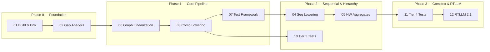

# CIRCT SystemC Cycle-Accurate Backend — Master Plan

> **Goal**: Extensively test and extend the CIRCT compiler's SystemC cycle-accurate
> model backend (`hw`/`comb`/`seq` → `systemc` → `emitc` → SystemC C++ → `libsystemc`),
> verify correctness via differential co-simulation against Verilator, and ultimately
> validate the entire pipeline against the **RTLLM 2.1** benchmark suite (50 RTL designs).

---

## Plan Documents

| # | Document | Purpose |
|---|----------|---------|
| 01 | [Environment & Build Setup](01-ENVIRONMENT-SETUP.md) | Repository structure, CIRCT build, SystemC/Verilator toolchain |
| 02 | [Pipeline Gap Analysis](02-PIPELINE-GAP-ANALYSIS.md) | Comprehensive audit of what works, what's missing, and what fails |
| 03 | [Comb → SystemC/EmitC Lowering](03-COMB-TO-SYSTEMC.md) | Implement emission/conversion for all 21 `comb` dialect ops |
| 04 | [Seq → SystemC Lowering](04-SEQ-TO-SYSTEMC.md) | Implement clocked register, memory, and clock-gate lowering |
| 05 | [HW Aggregates & Misc](05-HW-AGGREGATES.md) | Struct, array, union, enum, bitcast, wire support |
| 06 | [Graph Region Linearization](06-GRAPH-REGION-LINEARIZATION.md) | Topological ordering pass for use-before-def in graph regions |
| 07 | [Differential Test Framework](07-TESTING-FRAMEWORK.md) | Python/uv harness: CIRCT→SystemC vs. CIRCT→SV+Verilator co-sim |
| 08 | [Tier 1: Combinational Tests](08-TIER1-COMBINATIONAL-TESTS.md) | Pure-comb designs: adders, muxes, ALUs, wide types |
| 09 | [Tier 2: Sequential Tests](09-TIER2-SEQUENTIAL-TESTS.md) | Registers, FSMs, counters, shift registers |
| 10 | [Tier 3: Hierarchy Tests](10-TIER3-HIERARCHY-TESTS.md) | Multi-module instantiation, port binding, signal routing |
| 11 | [Tier 4: Complex Subsystems](11-TIER4-COMPLEX-TESTS.md) | Memories, FIFOs, datapaths, clock gating |
| 12 | [RTLLM 2.1 Integration](12-RTLLM-INTEGRATION.md) | Ingesting 50 RTLLM Verilog designs, SV→MLIR→SystemC→co-sim |

---

## Execution Phases

### Phase 0 — Foundation (Week 1)
- Perform clean environment setup, dependency installation, and CIRCT compilation in `external/build`.
- Smoke-test `circt-opt --convert-hw-to-systemc` + `circt-translate --export-systemc` on trivial `.mlir`.
- Document every failure mode against the gap analysis.

### Phase 1 — Core Pipeline (Weeks 2–4)
- Implement graph region linearization pass.
- Implement `comb` op emission patterns in `ExportSystemC` (or a `CombToEmitC` conversion pass).
- Build the differential co-simulation test framework (Python/uv + pytest).
- Validate with Tier 1 combinational test suite.

### Phase 2 — Sequential & Hierarchy (Weeks 5–8)
- Implement `seq` → SystemC lowering (registers, clock gating).
- Add HW aggregate type support (structs, arrays).
- Validate with Tier 2 (sequential) and Tier 3 (hierarchy) test suites.

### Phase 3 — Complex & RTLLM (Weeks 9–12)
- Validate Tier 4 (memories, FIFOs, datapaths).
- Integrate RTLLM 2.1 benchmark: ingest 50 Verilog designs via `circt-verilog` (Slang frontend),
  lower through the full pipeline, co-simulate against Verilator, and report pass/fail matrix.

---

## Key Design Decisions (from /grill-me)

| Decision | Choice |
|----------|--------|
| CIRCT source location | `external/circt/` inside `eda/circt-compiler/`, tracked on `develop-asd` branch |
| Build location | `external/build/` (unified LLVM+MLIR+CIRCT) |
| Git isolation | `external/` ignored by parent repo via `.gitignore`; CIRCT changes tracked separately |
| Build type | `RelWithDebInfo` + `LLVM_USE_SPLIT_DWARF=ON` for gdb debugging |
| SystemC backend target | Native `ExportSystemC` pipeline (`hw`/`comb`/`seq` → `systemc` → `emitc` → C++) |
| Verification strategy | Differential co-simulation: SystemC (`libsystemc`) vs. Verilator cycle-by-cycle |
| SystemC library | System-installed SystemC (`libsystemc-dev`) or custom `$SYSTEMC_HOME` |
