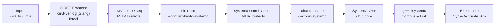

# 02 — Pipeline Gap Analysis

> Comprehensive audit of the CIRCT SystemC backend pipeline as of commit `650b3eb` on `main`
> (forked to `develop-asd`). This document catalogs every supported and unsupported construct
> across the three pipeline stages.

---

## 2.1 Pipeline Architecture

> [!CAUTION]
> **The pipeline is fundamentally broken for any non-trivial design.**
> Stage D (`HWToSystemC`) leaves all `comb` ops unconverted, and Stage F (`ExportSystemC`)
> has zero emission patterns for `comb`. Additionally, no `seq` dialect support exists at all.

---

## 2.2 Stage-by-Stage Gap Matrix

### Stage 1: `HWToSystemC` Conversion Pass

| Construct | Status | Details |
|-----------|--------|---------|
| `hw.module` → `systemc.module` | ✅ Converted | Ports, visibility, attributes preserved |
| `hw.instance` → `systemc.instance.decl` + bind | ✅ Converted | Input/output port binding with signal shortcuts |
| `hw.output` → `systemc.signal.write` | ✅ Converted | Output terminator consumed |
| `hw.constant` | ✅ Passed through | Marked legal; emitted by ExportSystemC |
| All 21 `comb.*` ops | ⚠️ Left unconverted | Marked legal but no emission patterns exist downstream |
| All `seq.*` ops | ❌ Fails | `SeqDialect` not in conversion target → illegal |
| `hw.module.extern` | ❌ Fails | No conversion pattern |
| `hw.wire` | ❌ Fails | No conversion pattern |
| `hw.bitcast` | ❌ Fails | No conversion pattern |
| `hw.array_*` (create/concat/slice/get/inject) | ❌ Fails | No conversion pattern |
| `hw.struct_*` (create/extract/inject/explode) | ❌ Fails | No conversion pattern |
| `hw.union_*` | ❌ Fails | No conversion pattern |
| `hw.enum.*` | ❌ Fails | No conversion pattern |
| `hw.param.value` (parameterized modules) | ❌ Explicit error | `"module parameters not supported yet"` |
| `hw.inout` port type | ❌ Explicit error | `"inout arguments not supported yet"` |
| Graph region cycles / use-before-def | ❌ Verifier error | SSACFG region requires dominance; no topo-sort |

### Stage 2: `ExportSystemC` C++ Emission

| Construct | Status | Emitted C++ |
|-----------|--------|-------------|
| `systemc.module` | ✅ | `SC_MODULE(name) { ... };` |
| `systemc.ctor` | ✅ | `SC_CTOR(name) { ... }` |
| `systemc.func` | ✅ | `void funcName() { ... }` |
| `systemc.method` / `systemc.thread` | ✅ | `SC_METHOD(f)` / `SC_THREAD(f)` |
| `systemc.sensitive` | ✅ | `sensitive << p1 << p2;` |
| `systemc.signal` | ✅ | `sc_signal<T> name;` |
| `systemc.signal.read` / `.write` | ✅ | `x.read()` / `x.write(v)` |
| `systemc.instance.decl` | ✅ | `ModType instName;` |
| `systemc.instance.bind_port` | ✅ | `inst.port(chan);` |
| `systemc.convert` | ✅ | Type cast (foldable) |
| `systemc.cpp.*` (variable, assign, new, delete, call, etc.) | ✅ | Standard C++ constructs |
| `emitc.include`, `emitc.call_opaque`, `emitc.cast`, etc. | ✅ | C++ equivalents |
| `hw.constant` | ✅ | Integer literal |
| **Any `comb.*` op** | ❌ | `<<UNSUPPORTED OPERATION>>` marker |
| **Any `seq.*` op** | ❌ | Not reached (blocked by Stage 1) |
| **Builtin `IntegerType` non-standard widths** (`i3`, `i7`, `i42`, `i128`) | ❌ | Emission fails (only i1/i8/i16/i32/i64 supported) |
| **Multi-block regions** | ❌ | `assert(region.hasOneBlock())` aborts |
| **`--export-split-systemc`** | ✅ (impl) | Untested (no regression test exists) |

### Stage 3: SystemC C++ Compilation & Execution

| Aspect | Status | Notes |
|--------|--------|-------|
| Compile emitted C++ with `g++ -lsystemc` | ❌ Never tested | No integration test compiles + runs a binary |
| `sc_main` testbench generation | ❌ Not implemented | No automated testbench wrapper exists |
| VCD/FST trace generation | ❌ Not implemented | Need `sc_trace` calls in generated code |
| Cycle-accurate co-simulation vs. Verilator | ❌ Not implemented | This plan's primary deliverable |

---

## 2.3 Type Conversion Coverage

### `HWToSystemC` Type Mapping

| Input Type | SystemC Type | Bit Range | Status |
|-----------|-------------|-----------|--------|
| `i1` | `i1` (→ `bool`) | 1 | ✅ |
| `iN` (2 ≤ N ≤ 64, unsigned/signless) | `!systemc.uint<N>` | 2–64 | ✅ |
| `iN` (2 ≤ N ≤ 64, signed) | `!systemc.int<N>` | 2–64 | ✅ |
| `iN` (65 ≤ N ≤ 512, unsigned/signless) | `!systemc.biguint<N>` | 65–512 | ✅ |
| `iN` (65 ≤ N ≤ 512, signed) | `!systemc.bigint<N>` | 65–512 | ✅ |
| `iN` (N > 512) | `!systemc.bv<N>` | >512 | ✅ |
| `!hw.array<N x T>` | — | — | ❌ |
| `!hw.struct<...>` | — | — | ❌ |
| `!hw.union<...>` | — | — | ❌ |
| `!hw.enum<...>` | — | — | ❌ |
| `!hw.inout<T>` | — | — | ❌ Explicit error |
| `!seq.clock` | — | — | ❌ |

### `ExportSystemC` Builtin Integer Emission

| Builtin Type | C++ Emission | Status |
|-------------|-------------|--------|
| `i1` | `bool` | ✅ |
| `i8` / `si8` / `ui8` | `[u]int8_t` | ✅ |
| `i16` / `si16` / `ui16` | `[u]int16_t` | ✅ |
| `i32` / `si32` / `ui32` | `[u]int32_t` | ✅ |
| `i64` / `si64` / `ui64` | `[u]int64_t` | ✅ |
| `i3`, `i7`, `i42`, `i128`, etc. | — | ❌ Emission fails |
| `index` | `size_t` | ✅ |

---

## 2.4 Existing Test Coverage Summary

| Test Category | Files | What's Tested | What's Missing |
|--------------|-------|---------------|----------------|
| `HWToSystemC` unit tests | 2 (`.mlir`) | Module conversion, instances, port binding, errors | End-to-end with comb/seq; compile validation |
| `SystemC` dialect tests | 7 (`.mlir`) | Parse/print, verifier errors, canonicalization, func | No comb/seq integration |
| `ExportSystemC` unit tests | 3 (`.mlir`) | C++ emission of all SystemC constructs, errors | No comb emission; no split export test |
| `ExportSystemC` integration | 2 (`.mlir`) | `clang-tidy` lint on emitted C++ | **No compilation, no execution, no simulation** |

> [!WARNING]
> **There is zero end-to-end test coverage**: no test takes an `hw.module` with combinational
> logic through the full pipeline to a running SystemC executable that produces verified output.

---

## 2.5 Priority-Ordered Work Items

| Priority | Item | Blocking | Estimated Effort |
|----------|------|----------|-----------------|
| **P0** | Graph region linearization (topo-sort) | All non-trivial designs | 2–3 days |
| **P0** | `comb` op emission/conversion (21 ops) | All combinational logic | 3–5 days |
| **P1** | Arbitrary bitwidth integer emission | Wide type designs | 1 day |
| **P1** | `seq.compreg` → SystemC clocked process | All sequential logic | 3–5 days |
| **P1** | `seq.compreg.ce` (clock enable) | Gated sequential | 1–2 days |
| **P2** | `hw.struct_*` / `hw.array_*` support | Aggregate data types | 3–5 days |
| **P2** | `hw.wire` lowering | Wire declarations | 1 day |
| **P2** | `hw.bitcast` lowering | Type casts | 1 day |
| **P2** | `hw.module.extern` support | External module decls | 1–2 days |
| **P3** | `seq.hlmem` / `seq.fifo` | Memory/FIFO designs | 3–5 days |
| **P3** | `seq.clock_gate` / `seq.clock_div` | Clock management | 2–3 days |
| **P3** | `hw.enum.*` / `hw.union_*` | Enum/union types | 2–3 days |
| **P3** | `hw.param.value` / parameterized modules | Generic designs | 3–5 days |
