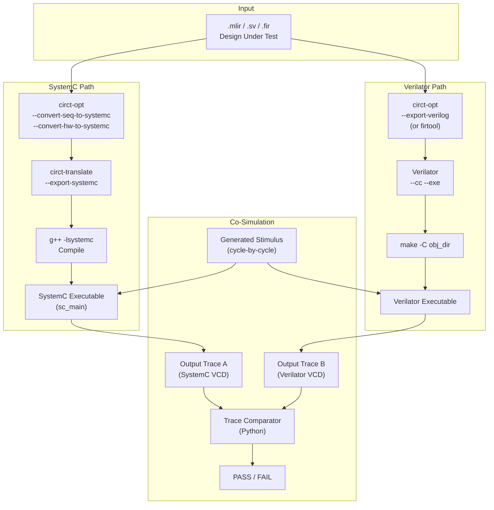

# 07 — Differential Co-Simulation Test Framework

> **Objective**: Build a Python/uv test harness that compiles CIRCT-generated SystemC C++
> and Verilator C++ from the same RTL input, drives both with identical cycle-by-cycle
> stimulus, and asserts output trace equivalence every cycle.

---

## 7.1 Architecture



---

## 7.2 Project Structure

```
tests/
├── pyproject.toml          # uv project: pytest, dependencies
├── conftest.py             # Shared fixtures: CIRCT binary paths, temp dirs
├── lib/
│   ├── __init__.py
│   ├── circt_runner.py     # Functions to invoke circt-opt, circt-translate
│   ├── systemc_compiler.py # Compile SystemC C++ with g++, generate sc_main wrapper
│   ├── verilator_runner.py # Run verilator --cc, compile, execute
│   ├── stimulus.py         # Generate random / directed cycle-by-cycle test vectors
│   ├── trace_compare.py    # Compare VCD/CSV output traces cycle-by-cycle
│   └── design_info.py      # Parse MLIR to extract port names, types, widths
├── designs/                # Shared test design inputs
│   ├── adder_32.mlir
│   ├── mux_4to1.mlir
│   ├── counter_8bit.mlir
│   └── ...
├── tier1_comb/             # Tier 1 test cases (see 08-TIER1)
│   ├── test_adder.py
│   ├── test_alu.py
│   └── ...
├── tier2_seq/              # Tier 2 test cases (see 09-TIER2)
├── tier3_hierarchy/        # Tier 3 test cases (see 10-TIER3)
├── tier4_complex/          # Tier 4 test cases (see 11-TIER4)
└── rtllm/                  # RTLLM 2.1 integration (see 12-RTLLM)
```

---

## 7.3 Key Components

### 7.3.1 `circt_runner.py` — CIRCT Tool Invocation

```python
# Constants hoisted to module level
CIRCT_BUILD_DIR = Path("external/build/bin")
CIRCT_OPT = CIRCT_BUILD_DIR / "circt-opt"
CIRCT_TRANSLATE = CIRCT_BUILD_DIR / "circt-translate"
FIRTOOL = CIRCT_BUILD_DIR / "firtool"

def lower_to_systemc(input_mlir: Path, output_mlir: Path) -> subprocess.CompletedProcess:
    """Run the full lowering pipeline: seq→systemc, hw→systemc."""
    return subprocess.run([
        str(CIRCT_OPT),
        "--convert-seq-to-systemc",   # Phase 2 addition
        "--convert-hw-to-systemc",
        str(input_mlir),
        "-o", str(output_mlir),
    ], capture_output=True, text=True, check=True)

def export_systemc(input_mlir: Path, output_cpp: Path) -> subprocess.CompletedProcess:
    """Translate SystemC MLIR to C++ source."""
    ...

def export_verilog(input_mlir: Path, output_sv: Path) -> subprocess.CompletedProcess:
    """Translate to SystemVerilog for Verilator path."""
    ...
```

### 7.3.2 `systemc_compiler.py` — SystemC Compilation

```python
import os
from pathlib import Path

# Compiler & SystemC paths (configurable via SYSTEMC_HOME or default system search)
GXX = os.getenv("CXX", "g++")
SYSTEMC_HOME = os.getenv("SYSTEMC_HOME")

def get_systemc_flags() -> list[str]:
    """Return include and link flags for SystemC."""
    flags = []
    if SYSTEMC_HOME:
        flags.extend([f"-I{Path(SYSTEMC_HOME) / 'include'}", f"-L{Path(SYSTEMC_HOME) / 'lib'}"])
    return flags

def generate_sc_main(design_info: DesignInfo, stimulus: list[dict], out_path: Path):
    """Generate sc_main.cpp that:
    1. Instantiates the DUT module
    2. Creates sc_clock for clock inputs
    3. Drives inputs cycle-by-cycle from stimulus list
    4. Captures outputs to CSV file each cycle
    5. Calls sc_stop() after all stimulus consumed
    """
    ...

def compile_systemc(sources: list[Path], output: Path) -> subprocess.CompletedProcess:
    """Compile SystemC C++ sources into executable."""
    cmd = [
        GXX, "-std=c++17", "-O2",
        *get_systemc_flags(),
        *[str(s) for s in sources],
        "-lsystemc",
        "-o", str(output),
    ]
    return subprocess.run(cmd, capture_output=True, text=True, check=True)
```

### 7.3.3 `verilator_runner.py` — Verilator Compilation

```python
VERILATOR = "verilator"

def compile_verilator(sv_file: Path, tb_cpp: Path, output_dir: Path):
    """Run verilator --cc --exe, then make."""
    subprocess.run([
        VERILATOR, "--cc", "--exe", "--build",
        "--trace",  # Generate VCD support
        "-o", str(output_dir / "Vtop"),
        str(sv_file), str(tb_cpp),
    ], check=True)

def generate_verilator_tb(design_info: DesignInfo, stimulus: list[dict], out_path: Path):
    """Generate C++ testbench for Verilator:
    1. Instantiate Vtop
    2. Drive inputs cycle-by-cycle
    3. Capture outputs to CSV
    """
    ...
```

### 7.3.4 `stimulus.py` — Test Vector Generation

```python
def generate_random_stimulus(
    ports: list[PortInfo],
    num_cycles: int,
    seed: int = 42,
) -> list[dict[str, int]]:
    """Generate deterministic random stimulus for all input ports."""
    rng = random.Random(seed)
    stimulus = []
    for _ in range(num_cycles):
        cycle = {}
        for port in ports:
            if port.direction == "input" and port.name != "clk":
                max_val = (1 << port.width) - 1
                cycle[port.name] = rng.randint(0, max_val)
        stimulus.append(cycle)
    return stimulus
```

### 7.3.5 `trace_compare.py` — Output Equivalence Check

```python
def compare_traces(
    systemc_csv: Path,
    verilator_csv: Path,
    tolerance_cycles: int = 0,  # Allow pipeline delay mismatch
) -> CompareResult:
    """Compare two CSV output traces cycle-by-cycle.

    Returns CompareResult with:
    - passed: bool
    - first_mismatch_cycle: Optional[int]
    - mismatched_signals: list[str]
    - total_cycles: int
    """
    ...
```

---

## 7.4 Test Flow for a Single Design

```python
# Example pytest test function
def test_adder_32bit(tmp_path, circt_tools):
    design = Path("tests/designs/adder_32.mlir")
    info = parse_design_info(design)

    # Generate stimulus
    stimulus = generate_random_stimulus(info.input_ports, num_cycles=100)

    # === SystemC Path ===
    sc_mlir = tmp_path / "sc.mlir"
    lower_to_systemc(design, sc_mlir)
    sc_cpp = tmp_path / "dut.h"
    export_systemc(sc_mlir, sc_cpp)
    sc_main = tmp_path / "sc_main.cpp"
    generate_sc_main(info, stimulus, sc_main)
    sc_exe = tmp_path / "sc_sim"
    compile_systemc([sc_cpp, sc_main], sc_exe)
    sc_csv = tmp_path / "sc_output.csv"
    subprocess.run([str(sc_exe), str(sc_csv)], check=True)

    # === Verilator Path ===
    sv_file = tmp_path / "dut.sv"
    export_verilog(design, sv_file)
    vl_tb = tmp_path / "tb.cpp"
    generate_verilator_tb(info, stimulus, vl_tb)
    compile_verilator(sv_file, vl_tb, tmp_path / "obj_dir")
    vl_csv = tmp_path / "vl_output.csv"
    subprocess.run([str(tmp_path / "obj_dir/Vtop"), str(vl_csv)], check=True)

    # === Compare ===
    result = compare_traces(sc_csv, vl_csv)
    assert result.passed, f"Mismatch at cycle {result.first_mismatch_cycle}: {result.mismatched_signals}"
```

---

## 7.5 Setup

```bash
cd eda/circt-compiler/tests
uv init
uv add pytest
uv run pytest tier1_comb/ -v
```

---

## 7.6 Acceptance Criteria

- [ ] Framework compiles SystemC C++ from CIRCT output and runs it
- [ ] Framework compiles Verilator C++ from CIRCT-exported SV and runs it
- [ ] Stimulus generation is deterministic (seeded RNG)
- [ ] CSV trace comparison reports first-mismatch cycle and signal
- [ ] At least one trivial design (passthrough) passes end-to-end co-simulation
- [ ] pytest integration with clear PASS/FAIL reporting
