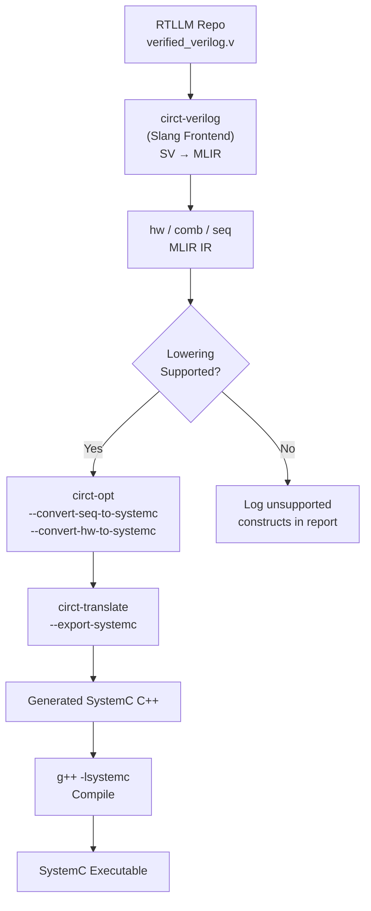

# 12 — RTLLM 2.1 Integration

> **Objective**: Validate the CIRCT SystemC backend against the 50 Verilog designs in the
> RTLLM 2.1 benchmark by ingesting each design's golden RTL, lowering it through the full
> pipeline, and co-simulating against Verilator using the provided testbenches.

---

## 12.1 RTLLM 2.1 Overview

- **Repository**: [github.com/hkust-zhiyao/RTLLM](https://github.com/hkust-zhiyao/RTLLM)
- **Version**: 2.1 (50 designs across 4 categories)
- **Per-design structure**:
  ```
  RTLLM/<design_name>/
  ├── design_description.txt    # Natural language spec
  ├── testbench.v               # Verilog testbench
  └── verified_verilog.v        # Golden RTL implementation
  ```

---

## 12.2 Design Categories (50 Designs)

### Arithmetic (≈15 designs)
| Design | Description | Key HW Constructs |
|--------|-------------|-------------------|
| `adder_8bit` | 8-bit adder | comb.add |
| `adder_16bit` | 16-bit from full adders | comb.add, hierarchy |
| `adder_32bit` | 32-bit carry-lookahead | comb.add, comb.and, comb.or |
| `adder_pipe_64bit` | 64-bit pipelined ripple carry | seq.compreg, comb.add |
| `adder_bcd` | BCD adder | comb.add, comb.icmp, comb.mux |
| `multi_8bit` | 8-bit multiplier | comb.mul |
| `multi_16bit` | 16-bit multiplier | comb.mul, hierarchy |
| `multi_pipe_8bit` | 8-bit pipelined multiplier | seq.compreg, comb.mul |
| `sub_64bit` | 64-bit subtractor | comb.sub |
| `div_16bit` | 16-bit divider | comb.divu, seq.compreg (iterative) |
| `radix2_div` | Radix-2 divider | comb.shl, comb.sub, seq.compreg |
| `ALU` | Arithmetic Logic Unit | comb.add/sub/and/or/xor/mux |

### Memory (≈8 designs)
| Design | Description | Key HW Constructs |
|--------|-------------|-------------------|
| `asyn_fifo` | Async FIFO (CDC) | seq.compreg, hw.array, dual clocks |
| `LIFObuffer` | LIFO stack | seq.compreg, hw.array, pointer |
| `barrel_shifter` | Barrel shifter | comb.mux, comb.shl/shru |
| `right_shifter` | Right shift register | seq.compreg, comb.extract |
| `LFSR` | Linear Feedback Shift Register | seq.compreg, comb.xor |

### Control (≈12 designs)
| Design | Description | Key HW Constructs |
|--------|-------------|-------------------|
| `counter_12` | Modulo-12 counter | seq.compreg, comb.icmp |
| `up_down_counter` | Bidirectional counter | seq.compreg, comb.add/sub, comb.mux |
| `FSM` | Finite state machine | seq.compreg, comb.icmp, comb.mux |
| `traffic_light` | Traffic light controller FSM | seq.compreg, FSM pattern |

### Miscellaneous (≈15 designs)
| Design | Description | Key HW Constructs |
|--------|-------------|-------------------|
| `freq_div` | Frequency divider | seq.compreg, comb.icmp |
| `freq_divbyeven` | Even frequency divider | seq.compreg |
| `freq_divbyodd` | Odd frequency divider | seq.compreg, dual-edge |
| `freq_divbyfrac` | Fractional freq divider | seq.compreg, comb.add |
| `risc_cpu` | Simplified RISC CPU | All constructs (extreme) |

---

## 12.3 Ingestion Pipeline



### Step-by-Step

1. **Clone RTLLM**:
   ```bash
   git clone https://github.com/hkust-zhiyao/RTLLM tests/rtllm/repo
   ```

2. **Ingest each design**:
   ```bash
   # Convert Verilog to MLIR using CIRCT's Slang frontend
   circt-verilog tests/rtllm/repo/<design>/verified_verilog.v \
     --ir-output-file=tests/rtllm/mlir/<design>.mlir
   ```

3. **Attempt lowering**:
   ```bash
   circt-opt \
     --convert-seq-to-systemc \
     --convert-hw-to-systemc \
     tests/rtllm/mlir/<design>.mlir \
     -o tests/rtllm/lowered/<design>.mlir 2>&1 | tee tests/rtllm/logs/<design>.log
   ```

4. **Export to SystemC C++**:
   ```bash
   circt-translate --export-systemc \
     tests/rtllm/lowered/<design>.mlir \
     > tests/rtllm/systemc/<design>.h
   ```

5. **Compile and simulate** (using testbench adaptation):
   See Section 12.4.

---

## 12.4 Testbench Adaptation

RTLLM provides Verilog testbenches (`testbench.v`). Two approaches to use them:

### Approach A: Extract Stimulus from Verilog TB (Recommended)
1. Parse the RTLLM `testbench.v` to extract input stimulus sequences.
2. Generate equivalent C++ stimulus for both SystemC and Verilator testbenches.
3. Use the differential co-simulation framework from [07-TESTING-FRAMEWORK.md](07-TESTING-FRAMEWORK.md).

### Approach B: Verilator-Only Reference
1. Compile `verified_verilog.v` + `testbench.v` with Verilator as the reference.
2. Capture output traces (VCD).
3. Compile SystemC-generated C++ with identical stimulus.
4. Compare traces.

---

## 12.5 Automation Script

```python
# tests/rtllm/run_rtllm.py
"""
Batch-process all 50 RTLLM designs through the CIRCT SystemC pipeline.
Generates a pass/fail report.
"""

STAGES = ["ingest", "lower", "export", "compile", "simulate", "compare"]

def process_design(design_name: str) -> dict:
    """Process a single RTLLM design through all stages."""
    result = {"design": design_name}
    for stage in STAGES:
        try:
            run_stage(stage, design_name)
            result[stage] = "PASS"
        except StageFailure as e:
            result[stage] = f"FAIL: {e.reason}"
            # Log the unsupported construct / error
            result["blocking_construct"] = e.construct
            break  # Stop at first failure
    return result

def generate_report(results: list[dict]) -> str:
    """Generate markdown report with pass/fail matrix."""
    ...
```

---

## 12.6 Expected Results & Triage

Based on the gap analysis, designs will be triaged into:

| Category | Expected Result | Count (est.) | Blocking Issue |
|----------|----------------|-------------|----------------|
| **Pure combinational** | PASS (after Phase 1) | ~5 | Comb emission |
| **Simple sequential** | PASS (after Phase 2) | ~15 | Seq lowering |
| **Array/struct types** | PASS (after Phase 2) | ~10 | HW aggregates |
| **Multi-clock / CDC** | FAIL | ~3 | Multi-clock domains not supported |
| **Complex CPU** | FAIL | ~2 | Too many unsupported constructs |
| **Partial support** | PARTIAL | ~15 | Various missing patterns |

### Triage Report Format

```markdown
## RTLLM Pass/Fail Matrix

| Design | Ingest | Lower | Export | Compile | Simulate | Compare | Blocking |
|--------|--------|-------|--------|---------|----------|---------|----------|
| adder_8bit | ✅ | ✅ | ✅ | ✅ | ✅ | ✅ | — |
| asyn_fifo | ✅ | ❌ | — | — | — | — | dual-clock |
| risc_cpu | ✅ | ❌ | — | — | — | — | hw.array, seq.hlmem |
```

---

## 12.7 Iterative Fix Cycle

For each FAIL:
1. Identify the **first failing stage** and the **blocking construct**.
2. Check if the construct is covered by plans 03–06.
3. If covered: implement the fix on `develop-asd`, rebuild, retry.
4. If not covered: file a new work item with priority based on frequency across RTLLM.
5. Re-run the batch and update the report.

---

## 12.8 Acceptance Criteria

- [ ] All 50 RTLLM designs are ingested via `circt-verilog` (Slang)
- [ ] Automated batch processing script runs all designs
- [ ] Pass/fail report is generated with per-stage breakdown
- [ ] At least 20/50 designs pass full pipeline (ingest → co-simulate)
- [ ] At least 30/50 designs pass through `circt-opt` lowering stage
- [ ] All pure-combinational RTLLM designs pass differential co-simulation
- [ ] Blocking constructs are cataloged for future work
- [ ] Report is updated after each fix iteration on `develop-asd`
