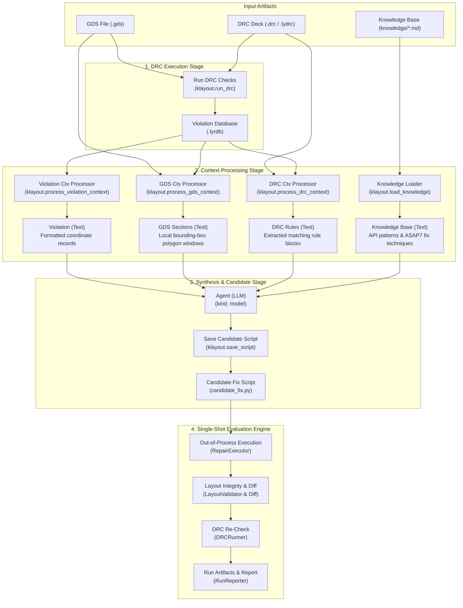

# Programmatic DRC with KLayout & DeepSeek Harness Flow

This repository provides an automated, programmatic pipeline for executing Design Rule Checking (DRC) on GDSII layouts using KLayout, extracting multi-modal context (rule decks, local layout geometry windows, violation tables, domain knowledge), and evaluating layout repair patches via the **DeepSeek Harness** (`dsh`) flow subsystem and a Python-native single-shot evaluation engine.

---

## Architecture Overview



The system is organized into three decoupled tiers:

1. **Python DRC, Context & Evaluation Engine (`src/klayout_drc/`)**:
   - `DRCRunner`: Executes KLayout in headless batch mode with profile-aware parameter binding.
   - `DRCParser`: Parses XML report databases (`.lyrdb`) into strongly typed violation data models.
   - `DRCReporter`: Produces formatted human-readable reports and structured JSON summaries.
   - `DRCContextProcessor`: Scans DRC decks and extracts only rule code blocks and thresholds matching violated rule names.
   - `GDSContextProcessor`: Crops bounding-box windows around violation markers (100nm halo) and extracts local polygon geometries and layer assignments.
   - `KnowledgeLoader`: Loads and merges Markdown domain knowledge documents from `knowledge/`.
   - `DRCFixer`: Deterministic geometric layout repair with KLayout Region operations.
   - `RepairExecutor`: Safely executes candidate scripts out-of-process via subprocess with timeout and log capture.
   - `LayoutValidator` & `LayoutDiffCalculator`: Validates GDS integrity (DBU, top-cell, non-empty shapes, bounding box sanity) and computes polygon diffs.
   - `RunReporter`: Produces structured audit bundles in `reports/runs/<run_id>/` with truthful status reporting (`success_geometry_only`, `partial`, `invalid_patch`, `model_error`, etc.).
   - `SingleShotOrchestrator`: Chains the complete `Fix → Apply Patch → Report` pipeline.
   - `cli.py`: Unified CLI with subcommands for all flow nodes and full evaluation.

2. **Harness Flow Subsystem (`harness/`)**:
   - Implements a local DeepSeek Harness product bundle (`@klayout/harness-drc`).
   - Declares the flow in `profile/catalog/flows/run_drc.yaml`.
   - Native flow model node (`kind: model`) using `generate_fix.md` system instructions.
   - Truthful error handling: LLM failures report `model_error` without silent heuristic substitution.

3. **Staged Roadmap & Documentation (`docs/`)**:
   - Phased execution from Foundation 0 to Phase C, keeping closed-loop iteration as an independent Goal D.
   - Detailed plan: [docs/STAGE_0_AND_A_IMPLEMENTATION_PLAN.md](docs/STAGE_0_AND_A_IMPLEMENTATION_PLAN.md).
   - Upstream roadmap package: [docs/ASAP7_Codex_Staged_Implementation_Package/](docs/ASAP7_Codex_Staged_Implementation_Package/).

---

## Directory Structure

```
klayout-4-drc/
├── pyproject.toml                     # Python package & CLI configuration (uv)
├── uv.lock                            # Deterministic uv lockfile
├── GEMINI.md                          # Project constitution & design principles
├── README.md                          # This documentation
├── docs/                              # Project documentation & staged roadmap
│   ├── STAGE_0_AND_A_IMPLEMENTATION_PLAN.md # Detailed implementation plan
│   └── ASAP7_Codex_Staged_Implementation_Package/ # Staged roadmap specifications
├── knowledge/                         # Domain knowledge base
│   ├── asap7_rules_guide.md           # ASAP7 layers, rules, and DBU grid
│   ├── geometric_fix_techniques.md    # Repair recipes (dilation, padding, keepout)
│   └── klayout_api_patterns.md        # KLayout Python API patterns (klayout.db / pya)
├── src/
│   └── klayout_drc/
│       ├── __init__.py                # Package exports
│       ├── config.py                  # Hoisted constants, paths, and exceptions
│       ├── runner.py                  # Headless KLayout batch process runner
│       ├── parser.py                  # Report database (.lyrdb) parser
│       ├── reporter.py                # Human-readable & structured reporter
│       ├── drc_context.py             # DRC rule deck extractor
│       ├── gds_context.py             # Windowed polygon layout extractor
│       ├── knowledge_loader.py        # Markdown knowledge base loader
│       ├── fixer.py                   # Automated layout repair logic
│       └── cli.py                     # Unified CLI entry point
├── test_data/
│   ├── layouts/
│   │   ├── asap7_test.gds             # Sample GDS with intentional violations
│   │   ├── asap7_fixed.gds            # Sample repaired GDS
│   │   └── create_sample_layout.py    # Generator for test layout
│   └── rules/
│       ├── asap7_mini.drc             # ASAP7 7nm mini DRC deck
│       └── drc_ASAP7.lydrc            # Full ASAP7 DRC deck (for Phase B)
├── reports/                           # Output directory for generated reports & runs
│   ├── drc_violations.lyrdb           # Intermediate KLayout report database
│   ├── drc_report.txt                 # Formatted textual report
│   └── runs/                          # Isolated per-run evaluation bundles (<run_id>/)
├── tests/
│   └── test_drc_pipeline.py          # End-to-end integration test suite
└── harness/                           # DeepSeek Harness integration bundle
    ├── package.json                   # Bundle package manifest
    ├── harness.product.json           # Harness product profile configuration
    ├── tsconfig.json                  # TypeScript configuration
    ├── scripts/
    │   ├── link-harness.mjs           # Safe compile-time symlink manager
    │   └── run-flow.mjs               # Standalone multi-node flow runner
    ├── profile/
    │   ├── cordis.patch.yml           # Cordis profile configuration
    │   └── catalog/
    │       └── flows/
    │           ├── run_drc.yaml       # 7-node Flow specification
    │           └── generate_fix.md    # Model instructions for agent node
    └── src/
        ├── index.ts                   # Cordis plugin entry point
        ├── drc-operations.ts          # Flow operation registration
        └── types.ts                   # Input/output schemas
```

---

## Quickstart & Usage

### 1. Python DRC Pipeline (`uv`)

```bash
# Execute end-to-end DRC check
uv run python -m klayout_drc.cli

# Execute granular flow nodes via CLI
uv run python -m klayout_drc.cli --mode run-drc --json
uv run python -m klayout_drc.cli --mode violation-ctx --json
uv run python -m klayout_drc.cli --mode drc-ctx --json
uv run python -m klayout_drc.cli --mode gds-ctx --json
uv run python -m klayout_drc.cli --mode load-knowledge --json
```

### 2. DeepSeek Harness Flow Execution

Run the flow from `harness/`:

```bash
cd harness
npm run flow:drc
```

The flow executes context extraction nodes, queries the model phase, and writes the candidate Python repair script.

### 3. Run Automated Tests

Execute the comprehensive integration test suite:

```bash
uv run pytest
```
