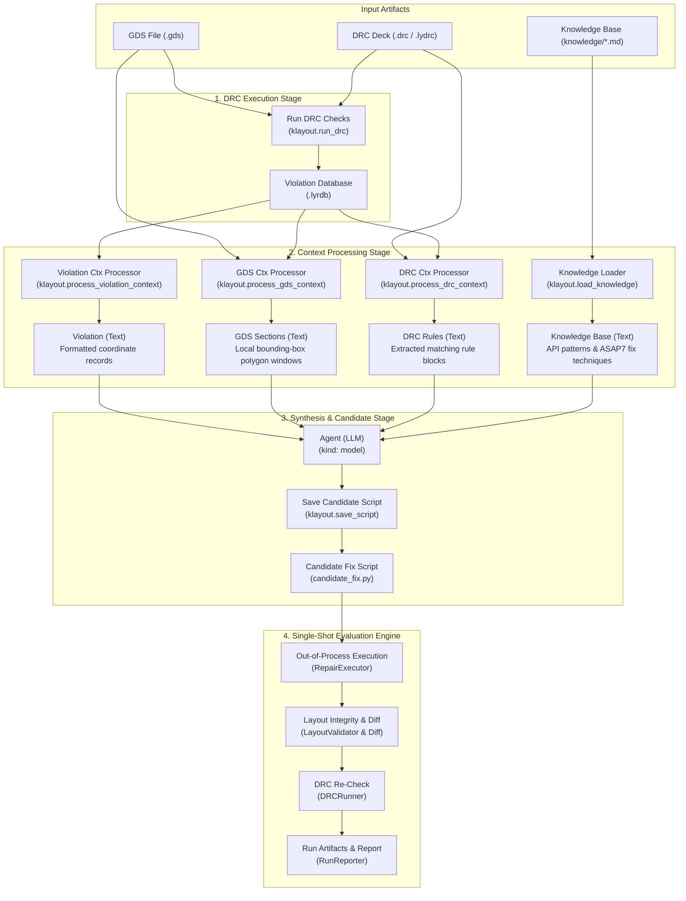

# Programmatic DRC with KLayout & DeepSeek Harness Flow

This repository provides an automated, programmatic pipeline for executing Design Rule Checking (DRC) on GDSII layouts using KLayout, extracting multi-modal context (rule decks, local layout geometry windows, violation tables, domain knowledge), and evaluating layout repair patches via the **DeepSeek Harness** (`dsh`) flow subsystem and a Python-native single-shot evaluation engine.

---

## Architecture Overview



The system is organized into three decoupled tiers:

1. **Python DRC, Context & Evaluation Engine (`src/klayout_drc/`)**:
   - `DRCRunner`: Executes KLayout in headless batch mode with profile-aware parameter binding.
   - `DRCDeckExtractor`: Unbundles `<klayout-macro>` XML envelopes and decodes XML entities.
   - `DRCRuleCatalog`: Audited rule catalog indexing constraints, physical layers, and upstream anomalies.
   - `MarkerGeometry`: Strongly typed models (`EdgeMarker`, `EdgePairMarker`, `PolygonMarker`, `BoxMarker`).
   - `DRCParser`: Parses XML report databases (`.lyrdb`) into strongly typed violation data models.
   - `DRCReporter`: Produces formatted human-readable reports and structured JSON summaries.
   - `DRCContextProcessor`: Scans DRC decks and extracts matching rule blocks and constraints.
   - `GDSContextProcessor`: Hierarchical windowed layout extractor applying instance coordinate transformations.
   - `KnowledgeLoader`: Loads and merges Markdown domain knowledge documents from `knowledge/`.
   - `DRCFixer`: Deterministic geometric layout repair with KLayout Region operations.
   - `RepairExecutor`: Safely executes candidate scripts out-of-process via subprocess with timeout and log capture.
   - `LayoutValidator` & `LayoutDiffCalculator`: Validates GDS integrity (DBU, top-cell, BEOL scope, master cell protection) and computes polygon diffs.
   - `RunReporter`: Produces structured audit bundles in `reports/runs/<run_id>/` with truthful status reporting (`success_geometry_only`, `partial`, `invalid_patch`, `model_error`, etc.).
   - `SingleShotOrchestrator`: Chains the complete `Fix → Apply Patch → Report` pipeline.
   - `cli.py`: Unified CLI with subcommands for all flow nodes and full evaluation.

2. **Harness Flow Subsystem (`harness/`)**:
   - Implements a local DeepSeek Harness product bundle (`@klayout/harness-drc`).
   - Declares the flow in `profile/catalog/flows/run_drc.yaml`.
   - Native flow model node (`kind: model`) using `generate_fix.md` system instructions.
   - Truthful error handling: LLM failures report `model_error` without silent heuristic substitution.

3. **Staged Roadmap & Documentation (`docs/`)**:
   - Phased execution from Foundation 0 to Phase C, keeping closed-loop iteration as an independent Goal D.
   - Phase B Plan: [docs/PHASE_B_IMPLEMENTATION_PLAN.md](docs/PHASE_B_IMPLEMENTATION_PLAN.md).
   - Phase B Evaluation Report: [docs/reports/asap7_phase_b_agent_evaluation.md](docs/reports/asap7_phase_b_agent_evaluation.md).
   - Stage 0 & A Plan: [docs/STAGE_0_AND_A_IMPLEMENTATION_PLAN.md](docs/STAGE_0_AND_A_IMPLEMENTATION_PLAN.md).
   - Upstream roadmap package: [docs/ASAP7_Codex_Staged_Implementation_Package/](docs/ASAP7_Codex_Staged_Implementation_Package/).

---

## Directory Structure

```
klayout-4-drc/
├── pyproject.toml                     # Python package & CLI configuration (uv)
├── uv.lock                            # Deterministic uv lockfile
├── GEMINI.md                          # Project constitution & design principles
├── README.md                          # This documentation
├── docs/                              # Project documentation & staged roadmap
│   ├── STAGE_0_AND_A_IMPLEMENTATION_PLAN.md # Detailed implementation plan
│   └── ASAP7_Codex_Staged_Implementation_Package/ # Staged roadmap specifications
├── knowledge/                         # Domain knowledge base
│   ├── asap7_rules_guide.md           # ASAP7 layers, rules, and DBU grid
│   ├── geometric_fix_techniques.md    # Repair recipes (dilation, padding, keepout)
│   └── klayout_api_patterns.md        # KLayout Python API patterns (klayout.db / pya)
├── src/
│   └── klayout_drc/
│       ├── __init__.py                # Package exports
│       ├── config.py                  # Hoisted constants, paths, and exceptions
│       ├── runner.py                  # Headless KLayout batch process runner
│       ├── parser.py                  # Report database (.lyrdb) parser
│       ├── reporter.py                # Human-readable & structured reporter
│       ├── drc_context.py             # DRC rule deck extractor
│       ├── gds_context.py             # Windowed polygon layout extractor
│       ├── knowledge_loader.py        # Markdown knowledge base loader
│       ├── fixer.py                   # Automated layout repair logic
│       └── cli.py                     # Unified CLI entry point
├── test_data/
│   ├── layouts/
│   │   ├── asap7_test.gds             # Sample GDS with intentional violations
│   │   ├── asap7_fixed.gds            # Sample repaired GDS
│   │   └── create_sample_layout.py    # Generator for test layout
│   └── rules/
│       ├── asap7_mini.drc             # ASAP7 7nm mini DRC deck
│       └── drc_ASAP7.lydrc            # Full ASAP7 DRC deck (for Phase B)
├── reports/                           # Output directory for generated reports & runs
│   ├── drc_violations.lyrdb           # Intermediate KLayout report database
│   ├── drc_report.txt                 # Formatted textual report
│   └── runs/                          # Isolated per-run evaluation bundles (<run_id>/)
├── tests/
│   └── test_drc_pipeline.py          # End-to-end integration test suite
└── harness/                           # DeepSeek Harness integration bundle
    ├── package.json                   # Bundle package manifest
    ├── harness.product.json           # Harness product profile configuration
    ├── tsconfig.json                  # TypeScript configuration
    ├── scripts/
    │   ├── link-harness.mjs           # Safe compile-time symlink manager
    │   └── run-flow.mjs               # Standalone multi-node flow runner
    ├── profile/
    │   ├── cordis.patch.yml           # Cordis profile configuration
    │   └── catalog/
    │       └── flows/
    │           ├── run_drc.yaml       # 7-node Flow specification
    │           └── generate_fix.md    # Model instructions for agent node
    └── src/
        ├── index.ts                   # Cordis plugin entry point
        ├── drc-operations.ts          # Flow operation registration
        └── types.ts                   # Input/output schemas
```

---

## Quickstart & Usage

### 1. Python DRC Pipeline (`uv`)

```bash
# Execute end-to-end DRC check
uv run python -m klayout_drc.cli

# Execute granular flow nodes via CLI
uv run python -m klayout_drc.cli --mode run-drc --json
uv run python -m klayout_drc.cli --mode violation-ctx --json
uv run python -m klayout_drc.cli --mode drc-ctx --json
uv run python -m klayout_drc.cli --mode gds-ctx --json
uv run python -m klayout_drc.cli --mode load-knowledge --json
```

### 2. DeepSeek Harness Flow Execution

Run the flow from `harness/`:

```bash
cd harness
npm run flow:drc -- --profile legacy_mini \
  --gds ../test_data/layouts/asap7_test.gds \
  --deck ../test_data/rules/asap7_mini.drc \
  --report-db ../reports/standalone/before.lyrdb \
  --output-script ../reports/standalone/candidate_fix.py
```

The flow executes context extraction nodes, queries the model phase, and writes the candidate Python repair script.

### 3. ASAP7 BEOL Benchmark Suite (100 Cases)

```bash
# List benchmark cases (with optional filtering by rule and tier)
uv run python -m klayout_drc.cli --mode benchmark-list --benchmark-rules M1.W.1 --benchmark-tiers boundary

# Verify cryptographic SHA-256 integrity of all 100 benchmark GDS files
uv run python -m klayout_drc.cli --mode benchmark-verify

# Run benchmark evaluation using fast heuristic solver
uv run python -m klayout_drc.cli --mode benchmark-evaluate --candidate-mode heuristic --benchmark-limit 5

# Run benchmark evaluation using LLM agent solver (gpt-6-luna)
uv run python -m klayout_drc.cli --mode benchmark-evaluate --candidate-mode agent --benchmark-rules M1.W.1 --benchmark-tiers isolated --benchmark-limit 1
```

### 4. Run Automated Tests

Execute the test suite (live API tests are opt-in):

```bash
uv run pytest
```

## Corrected C1 evaluation

C1 acceptance now uses result schema 2 and dataset release 1.1.0. The original
100 case geometries are unchanged. Repair rates exclude the 22 clean controls.
The 100 entries contain 93 distinct layouts. Candidate execution requires a
working Bubblewrap sandbox; it has no unrestricted fallback. Model requests
use profile-scoped facts and save exact request/response evidence.

See [C1 evaluation corrections](docs/C1_EVALUATION_CORRECTIONS.md) for contracts,
limits, tests, campaign commands, and remaining validation limits. The canonical
synthesis runner and declarative flow use the same request contract. Ordinary
tests do not make live API calls unless explicitly enabled.

For AWS Bedrock synthesis, set `KLAYOUT_DRC_MODEL_PROVIDER=bedrock`,
`BEDROCK_MODEL`, and `AWS_API_KEY`. `BEDROCK_REGION` defaults to
`ap-southeast-2`. See the
[AWS configuration and campaign instructions](docs/C1_EVALUATION_CORRECTIONS.md#aws-bedrock-candidate-provider).

The model now receives a runtime-verified KLayout Python API reference. See
[API guidance and matched ten-case results](docs/reports/c1_api_guidance_comparison.md).
The reference checks passed; the new pilot still had API execution failures and
did not meet the clean-control target. It was not expanded to 100 cases.

The four failed candidate copies now pass local checks after explicit API
corrections. See [local corrections and expanded API guidance](docs/reports/c1_api_failure_corrections.md).
These corrections do not change the recorded model scores.

The [single KLayout Python API reference](knowledge/klayout_api_patterns.md)
now covers repair and hierarchical geometry access in one generated document.
Both synthesis routes include it once. Every listed call form has executable
checks for the installed binding, and the document is capped at 18,000 characters.

## C2+C3 five-level benchmark

The independent C2+C3 benchmark adds real ASAP7 cell hierarchies, routed GCD and
UART sources, case-specific edit policies, and separate repair/control scoring.
Read [the benchmark guide](docs/C2_C3_BENCHMARK.md) for source pins and commands.
Read [the dataset manifest](test_data/benchmark_c2c3/manifest.json) for accepted
cases and completion status. Only qualified cases count toward the 50-case target.

The v1 corpus and evaluation are complete. Use the [50-case index](test_data/benchmark_c2c3/CASE_INDEX.md)
to inspect the full GDS files and clips. See the [measured results and failure analysis](docs/reports/c2_c3_benchmark_report.md)
for all three baselines, request accounting, and scope limits.

Use `.venv/bin/python -m klayout_drc.benchmark.c2c3.cli --help`. C1 files and
profiles remain separate. All C2+C3 outcomes are geometry-only.

## PicoRV32 ASAP7 flow

The [dedicated PicoRV32 case](flows/picorv32_asap7/README.md) runs pinned upstream
RV32IMC RTL through the OpenROAD RTL-to-GDS flow on ASAP7. It retains the final
GDS, DEF, OpenDB, netlist, SDC, SPEF, and public DRC audit for later autofix work.
See the case guide for setup, run, resume, and inspection commands.

## Portable handoff

Use `./scripts/drc` for setup, diagnostics, evidence transfer, evaluations, and saved reports.
See [Portable handoff](docs/PORTABLE_HANDOFF.md) for configuration and transfer commands.
The dated archive payload is transferred separately from Git.

Validation results: [Handoff validation](docs/HANDOFF_VALIDATION.md).
