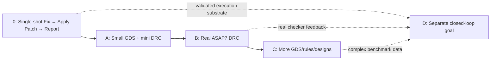

# ASAP7 Agentic DRC Repair — Staged Codex Implementation Roadmap

**Date:** 2026-10-21  
**Audience:** Codex and human reviewers  
**Repository:** https://github.com/ankdesh/build-with-terminator/tree/main/eda/gdsii/klayout-4-drc  
**Scope:** ASAP7 only; retain Python/KLayout and DeepSeek Harness (DSH).  
**Nature of documents:** Implementation plans, **not** records of executed experiments.

## Intent and changes relative to the original plan

The original comprehensive plan is preserved **byte-for-byte** as `ORIGINAL_ASAP7_DRC_Agent_Codex_Implementation_Plan.md`. This package adds **separate, independently reviewable implementation stages**. No original finding, caution, recommendation, work package, or reference has been deleted. The original work package WP4 (multi-attempt agentic closed loop) is **deferred into an independent design goal**; its eventual requirements are retained in the new Goal D report.

**Key sequencing choice:** Implement a reliable **single-attempt** `Fix → Apply Patch → Report` workflow **before** attempting Phases A, B, and C. Applying and validating one candidate is not a closed loop: there are no automatic retries, feedback-directed revisions, search, or self-correction.

## Stages and documents

| Order | Document | Goal | Primary deliverable | Dependency |
|---|---|---|---|---|
| 0 | `01_Foundation_Fix_Apply_Patch_Report.md` | Common reporting/execution foundation | One candidate is generated, applied in isolation, rechecked, and reported | None |
| A | `02_Phase_A_Current_Mini_GDS_and_Mini_DRC.md` | Prove current setup | End-to-end passing/failing runs on the existing small synthetic GDS and mini deck | Foundation |
| B | `03_Phase_B_Real_ASAP7_DRC.md` | Prove published ASAP7 DRC | Correct layer profile, real public deck, verified categories, real ASAP7 geometry | Phase A |
| C | `04_Phase_C_Expanded_GDS_Coverage.md` | Increase geometry and design coverage | Reproducible mutations, hierarchy, standard cells, optional OpenROAD full designs | Phase B |
| D, separate | `05_Separate_Goal_Closed_Loop_Repair.md` | Iterative agentic repair | **Separate design and acceptance proposal** for later implementation | Reliable outcomes from 0/A/B; desirable data from C |
| All | `06_Traceability_and_Codex_Handoff.md` | Preserve original recommendations | Finding/work-package mapping and suggested PR boundaries | N/A |

### Project trajectory

## Cross-cutting definitions (apply to all reports)

- `legacy_mini`: current three-rule synthetic DRC, with its **legacy synthetic layer conventions**; **not** genuine ASAP7 physical verification.
- `asap7_curated`: independently verified, reviewable selection of rules from the pinned public ASAP7 KLayout deck, explicitly labeled as **partial** verification.
- `asap7_public_full`: execute the version-pinned, wider public ASAP7 KLayout deck; it is **not** foundry signoff and known deck issues must be reported.
- `agent`: output created by the designated model. An LLM failure **must not silently fall back** to deterministic repair while retaining `agent` provenance.
- `heuristic_baseline`: separately selected deterministic fixer or generated heuristic script.
- `geometry_only`: DRC and layout integrity checked, but not independently proven to preserve electrical connectivity.
- `fully_validated`: reserved for cases where all required DRC, scope, and independent connectivity requirements are actually checked and satisfied.
- `report`: structured per-run result plus before/after checker artifacts, stage logs, code hash, deck hash, selected profile, and explicit validation scope.

## Overall implementation policy

1. Every stage must have a working command, positive and negative tests, artifacts, and a recorded acceptance result before proceeding.
2. Preserve the original input GDS; write each candidate to a **unique** run directory.
3. Preserve existing tests as regressions. Never silently rewrite the mini fixture to make it appear to be official ASAP7.
4. An empty or stale `.lyrdb`, unsupported DRC deck, missing dependency, corrupt output, or model failure is an **error or blocked state**, not success.
5. Generated repair code must be executed in a restricted OS/container sandbox with no secrets or network and bounded CPU/memory/time; AST/import checks alone are not a sandbox.
6. Changes are limited to the current repo, without altering DSH core or introducing a new orchestration framework.
7. Treat successful DRC as distinct from electrical correctness. Do not call a geometry-only test fully repaired unless connectivity is independently checked.
8. Track versions of the code, KLayout, Python, Node/DSH, source deck and designs. Large OpenROAD fixtures are optional/heavy tests, not default unit-test dependencies.
9. Existing initial goals (~5 independently verified rule categories, ~100 self-validating mutated cases) remain intact but are allocated to B and C rather than required before completing A.
10. Iterative closed-loop control is explicitly **out of scope for stages 0–C**. Stage 0 may expose data structures suitable for later feedback, but must not perform automatic retry/revision.

## Suggested Codex workflow

1. **Plan and implement `01` only.** Inspect current branch and produce file-level diff proposal; do not assume the document reflects changes already present locally.
2. Run focused tests and hand back stage artifacts and limitations.
3. Implement A without converting its legacy fixture to the public ASAP7 deck.
4. Only after A succeeds, implement B's technology/deck migration and rule-catalog improvements.
5. Implement C incrementally: C1 controlled geometry → C2 hierarchical/cell cases → C3 real routed designs.
6. Open a **separate planning task** for D; do not expand a simple single-shot workflow into an autonomous loop implicitly.

## Required review output per stage

Codex must report: files changed, command-line reproduction instructions, tests actually executed (pass/fail/blocked), before/after DRC evidence, checker and model provenance, validation strength, security assumptions, limitations, and the next stage's prerequisites.

## Source of truth and references

The original full implementation plan remains the authoritative inventory for F01–F15, WP0–WP8, original PR-00–PR-08, example schemas, and upstream source references. The stage documents refine **ordering and minimum acceptance**, not the original engineering requirements.
