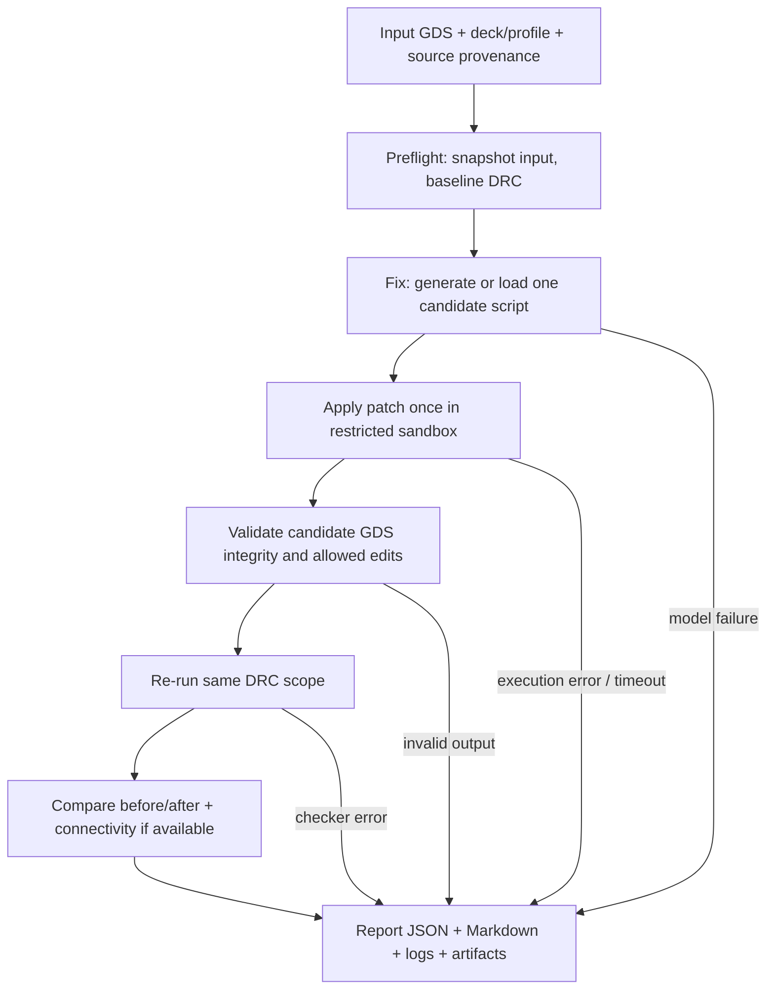

# Foundation 0 — Fix → Apply Patch → Report (single-attempt workflow)

**Stage:** Mandatory foundation for A, B, and C  
**Scope:** Minimal safe execution, verification, and reporting infrastructure, reusable with legacy mini or real ASAP7 decks  
**Excluded:** Automatic retries, feedback-driven code revision, competing-candidate search, or multi-attempt optimization (see Goal D)

## Goal and acceptance claim

Take a GDS layout, a selected DRC runset, and exactly **one** agent-generated (or explicitly labeled heuristic) Python repair candidate. **Apply** the patch to a writable copy, run the same selected DRC checker on the result, and **report** what happened with truthful validation status. The original GDS is immutable. A run is auditable even if script generation, execution, or DRC fails.

This foundation must work with both `legacy_mini` (`input/report`) and `asap7_public_full` (`in_gds/report_file`), but does **not** itself migrate the mini examples to authentic ASAP7 semantics.

## Required sequence



**Definition:** This is a **single-shot evaluation pipeline**. It may diagnose the patch and present a failure report, but it does not feed those diagnostics back into the model to produce another patch.

## Foundation tasks

### F0.1 — Establish baseline, immutable inputs, and provenance

- Inspect and run existing pytest/CLI/DSH entry points; record the actual current branch, dependency versions, failures, and legacy marker counts.
- Introduce a common `RunSpec`/`RunManifest` for: input GDS, top cell, DRC deck, named rule scope, agent/heuristic mode, model ID, configured sandbox limits, output root, and optional connectivity reference.
- Snapshot input and deck hashes before running anything. Avoid shared mutable `reports/fix_layout.py` as the authoritative run artifact.
- Validate tool presence, nonempty input GDS, top-cell resolution, and output directory safety before invoking a model.
- Leave profile migration to B; allow a minimal `legacy_mini` profile in F0 to prove the executor.

**Likely files:** `config.py`, `cli.py`, `runner.py`; new `run_manifest.py`, `profiles/legacy_mini.yaml` or equivalent.

### F0.2 — Generate or load a single repair candidate

- Support `mode=agent`, `mode=heuristic_baseline`, and an explicit `mode=script_file` for deterministic executor testing. Never label fallback heuristic code as model-generated.
- Keep the current DSH `kind:model` architecture; expose a canonical contract for saved script, rationale, generation status, model, and usage data.
- Model/HTTP errors produce `model_error` in the report. Remove silent fallback from the agent path of `harness/scripts/run-flow.mjs`; an independently selected heuristic run remains allowed.
- Verify candidate artifact exists and meets basic syntax/entrypoint checks (`fix_layout(input_gds, output_gds)` or a documented adapter). Syntax checks improve diagnostics, not security.

**Likely files:** `harness/scripts/run-flow.mjs`, `generate_fix.md`, `harness/src/types.ts`, `drc-operations.ts`, `cli.py`.

### F0.3 — Execute exactly one patch safely

- Implement `repair_executor.py`. Run generated Python **out of process**, in a disposable restricted OS/container sandbox without credentials/network, with read-only input/PDK files and a writable temporary output directory.
- Limit process runtime, memory, CPU, output size, and file access; capture stdout/stderr/exit code; sanitize file paths.
- Do not execute generated code inside the application process or rely on an import-denylist for containment.
- Require a new output GDS with a distinct path; never overwrite source/reference files.
- Detect syntax errors, nonzero exit, timeout, missing output, and invalid output independently.

### F0.4 — Validate and compare

- Require real parseable `.lyrdb` output; reject stale/nonexistent files, placeholder text, deck launch failure, and broken `.target.gds` fallback contracts.
- Verify output GDS readability, top-cell identity, units, permitted layers/cells, protected region consistency, and geometric changes. Introduce basic shape/layout diff now; hierarchy-aware expansion belongs in B/C.
- Run DRC on input and patched GDS with **identical deck, profile, flags and parameters**. Store both `.lyrdb` files.
- At minimum compare category counts and record total change; add typed marker matching later in B for `resolved/persisted/introduced/ambiguous`. **Never** claim detailed resolution from count differences alone.
- If source has known net tags, check net-separation invariants. Without a credible electrical check, success must remain `success_geometry_only`/`connectivity_unverified`.
- Explicitly reject deletion of all shapes, unexpected empty top cells, modification outside declared edit region, and mutation of protected geometry.

**Likely files:** `runner.py`, `parser.py`, `fixer.py` (heuristic-only), new `validator.py`, `layout_diff.py`.

### F0.5 — Always report

Per run, write a unique `reports/runs/<run_id>/` containing:

```text
reports/runs/<run_id>/
  run_manifest.json           # tool versions, commit/profile/deck/input hashes
  input.gds                   # immutable snapshot or content-addressed reference
  before.lyrdb               # verified pre-patch DRC database
  candidate_fix.py           # single proposed script, if generation succeeded
  candidate_stdout.log
  candidate_stderr.log
  patched.gds                # only if a real file was produced
  after.lyrdb                # only if second DRC ran
  layout_diff.json
  results.json               # structured verdict and gates
  report.md                  # human-readable before/fix/after story
```

Record absent artifacts as `null`/`not_run`, not invented file names or zeros.

Minimum report fields:

| Area | Required data |
|---|---|
| Identity | run/case ID, source revision, timestamps, profile/deck hashes |
| Generation | agent vs heuristic vs injected script, model identity, error, script hash |
| Apply | executable command, duration, exit code, timeout, logs, output GDS hash |
| DRC before/after | exact deck, parsed category counts, checker errors, marker-data availability |
| Safety | GDS integrity, allowed edit scope, protected cells/regions, connectivity status |
| Verdict | typed status, validation level, caveats/unsupported gates |
| Reproduction | input/patch references, commands, environment, seed where relevant |

**Suggested statuses:** `success_geometry_only`, `success_full` (only with independent connectivity verification), `partial`, `invalid_patch`, `no_change`, `model_error`, `drc_error`, `timeout`, `unsupported`.

A lower aggregate marker count is not automatically success; an output that removes original shapes or introduces new forbidden geometry is invalid. When robust spatial marker matching is unavailable, say counts only and `marker_matching=not_implemented`.

### F0.6 — DSH integration without a closed loop

- Preserve the existing seven conceptual stages and add `execute_patch` and `report_result` / `validate_result` as **single-shot** operations. Existing names and schemas can be versioned without silently breaking clients.
- Decide and document whether the DSH `kind:model` flow or `run-flow.mjs` is canonical. If both are retained, they must produce the same typed result format.
- Expose a nonagent `--script-file` execution route for repeatable tests that do not require an LLM API key.
- Make all failure paths deliver a report. The report operation must not disguise a failed patch as a successful run.

## Test matrix: required before Phase A

| Test | Required observation |
|---|---|
| Known script improves a mini example | Before/after `.lyrdb` exists, status reflects observed checks |
| Unchanged patch | `no_change` or `partial`, never clean success if violations remain |
| Syntax-invalid script | `invalid_patch`; model output captured if available |
| Infinite loop or excessive runtime | `timeout`, original unchanged |
| Script writes no GDS / wrong destination | Error and no fabricated after-DRC result |
| Script deletes all geometry | Safety rejection even if checker reports zero |
| Missing KLayout / invalid deck argument | `drc_error`; never zero violations |
| Malformed/placeholder `.lyrdb` | Explicit failure, no report success |
| Agent call fails | `model_error` and no unlabeled heuristic substitution |
| Repeated invocation | Independent run directories; inputs unchanged |

## Exit gate F0

- A **single** candidate script can be generated or supplied, executed once in isolation, and evaluated by DRC before/after.
- Reports exist and remain truthful for successful and failing runs.
- New runs preserve all original GDS/decks and document scope (`legacy_mini` vs public ASAP7).
- `fully_validated` is impossible without an implemented and passing independent electrical check.
- No model-to-model feedback or automatic retry is implemented.

## Handoff for Codex

**First produce:** file-level implementation proposal and schemas for single-shot execution and results. **Then implement** F0.1–F0.6 as small PRs with tests. Do not start geometry generation or replace legacy technology mappings during this foundation. Consult original plan WP0, WP3, WP8 and findings F03–F07, F11, F14.
