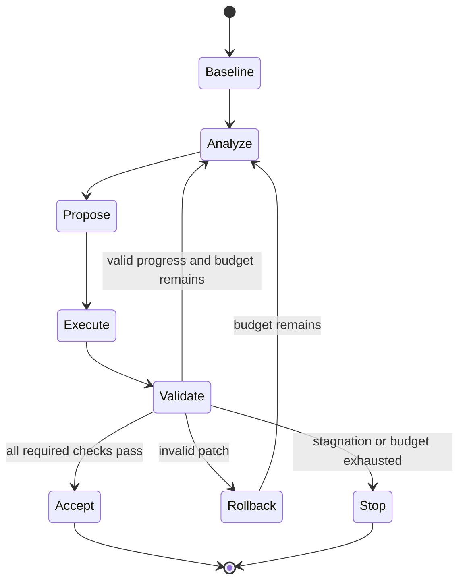

# Separate Goal D — Plan a True Closed-Loop Agentic DRC Repair System

**Status:** Separate **planning objective**, not part of Foundation 0 or Phases A/B/C  
**Motivation:** Once single-shot repair yields reliable before/after results, add a controller that can autonomously analyze failures, revise, and retry.

## Boundary: what is and is not a closed loop

Stages 0–C implement:

`Generate one fix → apply once → validate → produce a report → stop`.

A genuine closed loop implements:

`Analyze violations → propose candidate → apply → validate → choose next action using feedback → revise/retry → stop under constraints`.

Simply rerunning DRC after a patch is **verification**, not agentic iteration. **Do not insert automatic retries into Foundation, A, B, or C**. This design needs independent discussion, especially around state persistence, rule conflicts, cost, safety and convergence.

## Goal

Design a bounded, auditable DSH-native controller that can improve upon single-shot success on the *same fixed benchmark cases* while preserving the Foundation's sandbox, input immutability, checker provenance, connectivity gate, and honest failure reporting.

## Inputs inherited from completed work

- Immutable input GDS, PDK profile, rule deck, source connectivity metadata when available.
- Baseline DRC and typed marker geometry, clustered rule context, local hierarchy-aware windows.
- A tested `generate_candidate`, `execute_patch`, `validate_candidate`, `report_result` contract.
- Run and attempt artifacts with hashes, actual tool stderr, introduced/persisted/resolved markers, geometry/route diffs.
- Frozen benchmark subsets from A/B/C for fair single-shot vs closed-loop evaluation.

## Questions requiring a separate design decision

| Decision | Options / required analysis |
|---|---|
| Controller architecture | DSH workflow node loops, event-driven orchestration, or explicit outer controller built as DSH plugin (not LangGraph) |
| Canonical execution route | Catalog `kind:model` flow versus current manual-HTTP `run-flow.mjs`; unify contracts before looping |
| Granularity | Global patch, independent marker, spatial cluster, net cluster, or rule cluster |
| Candidate strategy | One next candidate vs beam/portfolio; patch a snapshot vs accumulate sequential approved edits |
| Backtracking | Always from immutable baseline, or from last accepted intermediate; rollback and conflict detection |
| Progress signal | Resolved markers, severity, new violations, protected edits, connectivity, timing and patch cost |
| Constraints | Never prefer a numerically smaller DRC count if a short/open/protected edit is introduced |
| Convergence | No-change detection, repeated script/layout hashes, cycling, stale checker data |
| Budget | Maximum attempts (proposed initial 3), runtime, model tokens/cost, patch area, iterations without progress |
| Error path | Model errors, patch syntax errors, checker exceptions, missing net data, irreducible conflicts |
| User intervention | What failures need review and what tool outputs should be surfaced before human edits |
| Reproducibility | Persistent attempt tree, selected/losing candidates, versions, and resume semantics |

## Suggested high-level state machine (for design review)

Avoid interpreting the diagram as an implementation mandate: it only frames decisions. The full design should specify durable state, idempotence and recovery after interruption.

## Original technical recommendations retained for D

From original WP4:

1. Extend DSH flow beyond script saving with execute/validate/decision and a bounded number of attempts; start by **evaluating** a configurable three-attempt budget rather than assuming it is optimal.
2. Supply targeted feedback: surviving/new violations, relevant constraints, script stderr, protected-region and connectivity failures, and context completeness.
3. Explicit modes: `agent`, `heuristic_baseline`, `analyze_only`; no silent fallback from failed model run to a different algorithm.
4. Typed model inputs: `technology_profile`, `rule_context`, `violation_clusters`, `local_geometry`, `protected_shapes`, `connectivity_context`, `allowed_operations`, `feedback`.
5. Preserve DSH model nodes and plugin integration, or document a canonical alternate runner sharing the same contracts. Do not alter DSH core.
6. Preserve typed statuses (`success_full`, `success_geometry_only`, `partial`, `invalid_patch`, `model_error`, `drc_error`, `timeout`, `no_change`, `unsupported`) and per-attempt hashes/costs.
7. Failed attempts never overwrite original or previously accepted GDS. A repeated no-op or cyclic patch terminates correctly.

## Planning deliverables (before coding)

1. Architecture decision record (ADR) for DSH-native iteration and canonical executor.
2. State machine with restart, rollback and bounded-iteration semantics.
3. Attempt tree/ledger schema and feedback DTO contracts in Python and TypeScript.
4. Patch selection/acceptance policy prioritizing valid connectivity and no unapproved new violations over count-only improvements.
5. Safety/threat model for repeated execution of generated Python.
6. Frozen evaluation set and experiment protocol comparing single-shot versus multi-attempt runs at equal or clearly reported budgets.
7. File-level change plan, required tests, and PR breakdown. **No automatic loop implementation until this design is reviewed.**

## Proposed evaluation (later)

| Experiment | Expected observation |
|---|---|
| Single-shot vs bounded loop on identical held-out cases | Real incremental benefit versus added latency and tokens |
| No feedback vs structured rule/marker feedback | Contribution of diagnostic context |
| Sequential patch vs restart-from-baseline | Trade-offs in accumulation and regression |
| Clustered vs global repair | Scaling and conflict characteristics |
| Synthetic mini vs real ASAP7 vs routed GDS | Generality across difficulty |
| Failures: cyclic proposals, invalid patch, timeout, model error | Honest termination and preserved input |

Infrastructure test thresholds should demand *correctness, idempotence, truthful status, and safety*, not arbitrary model success percentages. Measure repair improvement empirically.

## Interface boundary for 0/A/B/C

Provide structured before/after markers, patch execution result, validation gates, provenance and candidate artifacts in the current stages. **Do not require or implement D-specific callbacks or loops now.** This gives the later controller a strong substrate without forcing a premature orchestration choice.

## Entry and exit gates for the design task

**Enter design when:** Foundation can execute and report one script, Phase A has reliable small-case results, and Phase B has a verified public-deck path. Phase C complex cases are strongly desirable for evaluating the chosen architecture but not necessary for drafting it.

**Design complete when:** Choices and open risks are recorded, typed interfaces and failure-state behavior are specified, and a separately approved PR implementation sequence exists. An autonomous repair implementation is a **later** milestone, not part of this report's definition of done.

## Codex handoff

Treat D as a separate planning task. Read `ORIGINAL_ASAP7_DRC_Agent_Codex_Implementation_Plan.md` WP4 in full, plus Foundation `01`. Produce a design document and alternatives with pros/cons before implementing any loop. Preserve DSH-only orchestration constraints and the existing safety validator.
