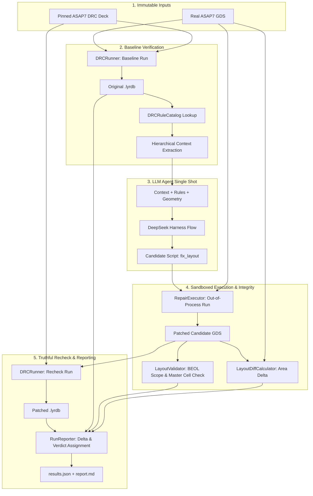

# Phase B Implementation Plan: Real Public ASAP7 DRC Migration

**Target Milestone:** Phase B — Technology Migration & Real Public ASAP7 DRC Integration  
**Document Version:** 1.0.0  
**Status:** Ready for Review & Execution  
**Dependencies:** Foundation Stage 0 (Single-shot pipeline) & Phase A (`legacy_mini` verification)  
**Constitutional Compliance:** [GEMINI.md](file:///home/ankdesh/explore/build-with-terminator/eda/gdsii/klayout-4-drc/GEMINI.md)

---

## 1. Executive Summary & Goals

### 1.1 Purpose & Scope
Phase B transitions `klayout-4-drc` from synthetic miniature technology assumptions (`legacy_mini`: 2 layers, 3 toy rules) to an authentic, pinned **ASAP7 7nm Predictive FinFET** technology stack and the public KLayout DRC deck (`asap7.lydrc`).

In this phase, we:
1. **Pin and audit** the authoritative upstream OpenROAD/ASAP7 DRC deck (`flow/platforms/asap7/drc/asap7.lydrc`) and PDK layer mappings.
2. **Disambiguate** layout database units (DBU: e.g., $0.001\ \mu\text{m}$ vs $0.00025\ \mu\text{m}$) from technological manufacturing grids ($0.00025\ \mu\text{m}$ / $0.25\text{ nm}$).
3. **Parse real XML-wrapped `.lydrc` macro files** and extract Ruby DSL rule definitions, handling XML entity decoding (`&lt;`, `&gt;`, `&amp;`), blank category names (`M1.S.2`), and duplicate categories (`V1.M1.EN.1`).
4. **Implement an audited rule catalog** (`rule_catalog.py`) mapping checker categories to source line ranges, expressions, derived layers, and physical boundary constraints.
5. **Normalize ReportDatabase (`.lyrdb`) markers** into strongly typed numeric geometries (`edge`, `edge_pair`, `polygon`, `box`) preserving coordinate precision and hierarchy.
6. **Support hierarchical layout context extraction** (`gds_context.py`), walking instance trees with transformation matrices (translation, rotation, magnification, reflection).
7. **Construct and verify 5 BEOL rule families** across a rigorous **4-case boundary test matrix** (Legal, Legal Boundary, Illegal Boundary, Clearly Illegal).
8. **Execute single-shot agent repair** (`OPENAI_MODEL="gpt-6-luna"`) against authentic ASAP7 testcases, enforcing BEOL-only edit scopes and master-cell protection, with truthful reporting (`success_geometry_only`).

### 1.2 Invariants & Non-Goals
* **Non-Goal (Deferred to Phase C)**: Randomized large-scale testcase generation and complex OpenROAD full-chip block repair.
* **Non-Goal (Deferred to Goal D)**: Multi-turn iterative closed-loop repair with retry budgets. Phase B strictly enforces the single-shot `Fix → Apply Patch → Report` contract.
* **Invariant (Phase A Backward Compatibility)**: The synthetic `legacy_mini` test suite and fixtures (`test_data/layouts/legacy_mini_v2/`) must remain 100% operational under their dedicated profile without regressions.
* **Invariant (Truthful Status Reporting)**: No successful DRC run is reported as `fully_validated` without netlist/connectivity proof; results without LVS are truthfully classified as `success_geometry_only`.
* **Invariant (Fail Explicitly & Early)**: Missing tools, deck mismatches, XML parse errors, or missing output databases fail immediately with typed exceptions (`DRCExecutionError`, `DRCParserError`, `DRCConfigurationError`).

---

## 2. Upstream Collateral & Technology Mapping

### 2.1 PDK & DRC Deck Provenance
We pin the upstream DRC deck from OpenROAD-flow-scripts:
* **Upstream Repository**: [The-OpenROAD-Project/OpenROAD-flow-scripts](https://github.com/The-OpenROAD-Project/OpenROAD-flow-scripts)
* **Relative Path**: `flow/platforms/asap7/drc/asap7.lydrc`
* **Reference Community Deck**: [laurentc2/ASAP7_for_KLayout](https://github.com/laurentc2/ASAP7_for_KLayout)
* **License**: BSD 2-Clause License (Copyright (c) 2021, laurentc2)
* **Deck Format**: KLayout XML Macro `<klayout-macro>` containing Ruby DRC DSL in `<text>`.
* **Runner CLI Variables**:
  - Input GDS: `in_gds` (bound via `-rd in_gds=<path>`)
  - Report Output: `report_file` (bound via `-rd report_file=<path>`)

### 2.2 Authentic Layer Mapping
The pinned deck establishes the following physical layer assignments:

| Physical Layer | GDS Layer / Datatype | Description | Phase B Status |
| :--- | :--- | :--- | :--- |
| `V0` | 18 / 0 | Via 0 (connects LiG/LiSD to M1) | **Target BEOL** |
| `M1` | 19 / 0 | Metal 1 (horizontal routing track) | **Target BEOL** |
| `M2` | 20 / 0 | Metal 2 (vertical routing track) | **Target BEOL** |
| `V1` | 21 / 0 | Via 1 (connects M1 to M2) | **Target BEOL** |
| `V2` | 25 / 0 | Via 2 | Supported in Catalog |
| `M3` | 30 / 0 | Metal 3 | Supported in Catalog |
| `V3` | 35 / 0 | Via 3 | Supported in Catalog |
| `M4` | 40 / 0 | Metal 4 | Supported in Catalog |
| `Gate` | 7 / 0 | Gate Poly (FEOL) | Protected / Read-only |
| `Active` | 11 / 0 | Active FinFET Region (FEOL) | Protected / Read-only |

### 2.3 Database Units (DBU) vs Manufacturing Grid
* **Layout DBU (`layout.dbu`)**: Extracted dynamically from the GDS header using `klayout.db.Layout.dbu`. Authentic ASAP7 GDS files typically use $0.00025\ \mu\text{m}$ ($0.25\text{ nm}$ per database unit), while legacy or standard tool flows may use $0.001\ \mu\text{m}$ ($1\text{ nm}$).
* **Manufacturing Grid**: The physical grid step for ASAP7 is $0.00025\ \mu\text{m}$ ($0.25\text{ nm}$) or $1\text{ nm}$ depending on lithography constraints.
* **Coordinate Conversion Contract**: All geometric coordinates internal to the agent, rule catalog, and marker database are normalized to floating-point physical microns ($\mu\text{m}$) before comparison, ensuring that identical geometries in $0.001\ \mu\text{m}$ and $0.00025\ \mu\text{m}$ DBUs evaluate identically.

### 2.4 Profile Specification Hierarchy
We maintain three explicit profile types managed by `DRCProfileManager` in `src/klayout_drc/profile.py`:

```yaml
# 1. Legacy Mini (Phase A Regression)
legacy_mini:
  description: "Synthetic ASAP7 3-rule mini DRC deck with legacy layer conventions"
  deck_path: "test_data/rules/asap7_mini.drc"
  param_in_gds: "input"
  param_report: "report"
  layers:
    M1: [18, 0]
    V1: [19, 0]
  dbu_um: 0.001

# 2. ASAP7 Curated (Phase B Audited BEOL Subset)
asap7_curated:
  description: "Audited subset of 5 BEOL rule families with normalized category identifiers"
  deck_path: "test_data/rules/asap7_curated.lydrc"
  param_in_gds: "in_gds"
  param_report: "report_file"
  layers:
    V0: [18, 0]
    M1: [19, 0]
    M2: [20, 0]
    V1: [21, 0]
  dbu_um: 0.00025

# 3. ASAP7 Public Full (Pinned OpenROAD Public Deck)
asap7_public_full:
  description: "Authentic pinned public OpenROAD KLayout DRC deck"
  deck_path: "test_data/rules/asap7.lydrc"
  param_in_gds: "in_gds"
  param_report: "report_file"
  layers:
    V0: [18, 0]
    M1: [19, 0]
    M2: [20, 0]
    V1: [21, 0]
    V2: [25, 0]
    M3: [30, 0]
  dbu_um: 0.00025
```

---

## 3. Architecture & Module Design

Following the project rule of **one primary class per file**, the Phase B implementation introduces and refines the following architecture:

```
src/klayout_drc/
├── config.py                 # Central configuration, constants, error types
├── profile.py                # DRCProfile and DRCProfileManager (WP1)
├── runner.py                 # DRCRunner with parameter adapter and exit validation (WP1)
├── deck_extractor.py         # [NEW] DRCDeckExtractor: XML macro unbundler & entity decoder (WP2)
├── rule_catalog.py           # [NEW] DRCRuleCatalog & DRCRuleDefinition (WP2)
├── marker_geometry.py        # [NEW] Typed marker geometry models (edge, edge-pair, polygon, box) (WP2)
├── parser.py                 # DRCParser: Typed ReportDatabase parser using marker_geometry (WP2)
├── gds_context.py            # GDSContextProcessor: Hierarchical window extraction with transforms (WP2)
├── drc_context.py            # DRCContextProcessor: Binding RDB violations to RuleCatalog (WP2)
├── validator.py              # LayoutValidator: BEOL layer scope & master cell protection (WP3)
├── layout_diff.py            # LayoutDiffCalculator: Per-layer polygon diffing (WP3)
├── repair_executor.py        # RepairExecutor: Out-of-process candidate execution (WP3)
├── run_reporter.py           # RunReporter: Verdict evaluation and report generation (WP3)
├── single_shot.py            # SingleShotOrchestrator: Phase B single-shot pipeline (WP3/WP5)
└── cli.py                    # Unified CLI supporting Phase B profiles and modes
```

### 3.1 `DRCDeckExtractor` (`src/klayout_drc/deck_extractor.py`)
* **Role**: Parses XML-wrapped `<klayout-macro>` files (`asap7.lydrc`), extracts the embedded Ruby DSL script from the `<text>` element, decodes all XML entities (`&lt;` $\to$ `<`, `&gt;` $\to$ `>`, `&amp;` $\to$ `&`, `&quot;` $\to$ `"`), and tracks line numbers to maintain source provenance.
* **Error Handling**: Raises `DRCParserError` if the XML is malformed or missing the `<text>` block.

### 3.2 `DRCRuleCatalog` (`src/klayout_drc/rule_catalog.py`)
* **Role**: Maintains a strongly typed inventory of DRC rules:
  ```python
  @dataclass(frozen=True)
  class RuleConstraint:
      constraint_type: str  # "min_width", "min_spacing", "min_area", "min_enclosure"
      value_um: float
      condition: str | None = None  # e.g., "parallel_run_length > 36nm"

  @dataclass(frozen=True)
  class DRCRuleDefinition:
      rule_id: str
      category_name: str
      description: str
      source_deck: str
      source_line_start: int
      source_line_end: int
      raw_source_snippet: str
      target_layers: tuple[str, ...]
      constraints: tuple[RuleConstraint, ...]
      is_ambiguous: bool = False
      upstream_anomaly: str | None = None
  ```
* **Upstream Anomalies Handled**:
  - `M1.S.2`: Deck outputs category `"  "` (blank whitespace). The catalog maps this explicitly to `M1.S.2` with an anomaly note.
  - `V1.M1.EN.1`: Reused across two separate checks (enclosure along opposite sides vs corner overlap). Catalog tracks both constraint branches without dropping either.

### 3.3 `MarkerGeometry` (`src/klayout_drc/marker_geometry.py`)
* **Role**: Provides strongly typed, validated representations of RDB markers:
  - `EdgeMarker`: Start and end points $(x_1, y_1) \to (x_2, y_2)$ in physical $\mu\text{m}$.
  - `EdgePairMarker`: Pair of edges representing spacing or width violations, with computed separation distance.
  - `PolygonMarker`: Closed boundary vertex list $(x_i, y_i)$ with computed area and perimeter.
  - `BoxMarker`: Rectangular bounding box $(x_1, y_1, x_2, y_2)$.
* **Comparison Contract**: Quantized spatial hashing with tolerance (e.g., $\epsilon = 0.5\text{ nm}$) to reliably detect whether a marker was `resolved`, `persisted`, or `introduced` across runs.

### 3.4 Hierarchical GDS Context Extraction (`src/klayout_drc/gds_context.py`)
* **Instance Hierarchy Traversal**: Rather than only reading top-cell shapes (`layout.top_cell().shapes()`), recursively walk `each_child_cell()` and `each_inst()`.
* **Coordinate Transforms**: Apply cumulative `CplxTrans` (complex transformations including scaling, rotation in $90^\circ$ increments, mirroring, and displacement) to map child cell shapes into top-cell world coordinates.
* **Window Clipping**: Extract shapes intersecting a bounding box halo $[(x_{\min} - \Delta, y_{\min} - \Delta), (x_{\max} + \Delta, y_{\max} + \Delta)]$ around violation markers.
* **Deterministic Limits**: Cap polygon count per window, flag truncated context (`is_truncated: bool`), and record completeness.

### 3.5 Repair Validator & Protection Policies (`src/klayout_drc/validator.py`)
* **BEOL-Only Policy**: Asserts that only layers declared in the profile's editable list (`V0`, `M1`, `M2`, `V1`) contain shape diffs. If FEOL layers (`Gate`, `Active`, `Fin`) or unlisted layers are modified, the validator rejects the repair with `status = "invalid_patch"` and an explicit error explanation.
* **Master-Cell Immutability**: If standard-cell subcells or library instances exist, validates that child cell definitions are untouched and edits are confined to top-level interconnect routing.

---

## 4. Target 5 BEOL Rule Families & 4-Case Boundary Test Matrix

To independently prove checker accuracy and source-to-marker traceability, we implement and verify **5 core BEOL rule families** in the pinned ASAP7 deck:

### 4.1 Selected Rule Families

| ID | Rule Family | PDK Description | Specification Threshold | Upstream Ruby Expression |
| :--- | :--- | :--- | :--- | :--- |
| **1** | `M1.W.1` | M1 minimum width | Width $\ge 18\text{ nm}$ ($0.018\ \mu\text{m}$) | `m1.width(18.nm).output("M1.W.1", ...)` |
| **2** | `M2.W.1` | M2 minimum width | Width $\ge 18\text{ nm}$ ($0.018\ \mu\text{m}$) | `m2.width(18.nm).output("M2.W.1", ...)` |
| **3** | `M1.A.1` | M1 minimum area | Area $\ge 504\text{ nm}^2$ ($0.000504\ \mu\text{m}^2$) | `m1.with_area(0 .. 0.000504).output("M1.A.1", ...)` |
| **4** | `M1.S.1` | M1 spacing (parallel edges $> 36\text{ nm}$) | Spacing $\ge 18\text{ nm}$ ($0.018\ \mu\text{m}$) | `m1.space(18.nm).polygons.not_interacting(m1.edges.with_length(0..36.nm)).output("M1.S.1", ...)` |
| **5** | `V1.M1.EN.1` | V1 enclosure by M1 on opposite sides | Enclosure $\ge 5\text{ nm}$ & $2\text{ nm}$ | `v1.interacting(m1.enclosing(v1, 2.nm, ...).edges - ...).output("V1.M1.EN.1", ...)` |

### 4.2 4-Case Boundary Test Matrix per Rule Family
For each of the 5 rule families, we construct a deterministic testcase generator producing 4 distinct layout states on manufacturing grid ($0.00025\ \mu\text{m}$ / $0.25\text{ nm}$):

```
                        Legal Margin
                             ▲
                             │   [Case 1: Legal (Wide Margin)]
                             │   e.g., M1 Width = 24.0 nm (PASS)
                             │
       Legal Boundary ───────┼───[Case 2: Legal Boundary (Exact Threshold)]
                             │   e.g., M1 Width = 18.0 nm (PASS)
─────────────────────────────┼───────────────────────────────────────────── DRC Limit
                             │
     Illegal Boundary ───────┼───[Case 3: Illegal Boundary (-1 Grid Step)]
                             │   e.g., M1 Width = 17.75 nm (FAIL: 1 Violation)
                             │
                             │   [Case 4: Clearly Illegal (Gross Defect)]
                             ▼   e.g., M1 Width = 10.0 nm (FAIL: 1 Violation)
```

#### Detailed Test Specification:

1. **`M1.W.1` (Minimum Width)**:
   - **Case 1 (Legal)**: Rectangle of width $24.0\text{ nm}$, length $100\text{ nm}$. $\to$ Expected: **0 violations**.
   - **Case 2 (Legal Boundary)**: Rectangle of width $18.0\text{ nm}$, length $100\text{ nm}$. $\to$ Expected: **0 violations**.
   - **Case 3 (Illegal Boundary)**: Rectangle of width $17.75\text{ nm}$ ($18\text{ nm} - 0.25\text{ nm}$ grid step), length $100\text{ nm}$. $\to$ Expected: **1 violation (`M1.W.1`)**.
   - **Case 4 (Clearly Illegal)**: Rectangle of width $10.0\text{ nm}$, length $100\text{ nm}$. $\to$ Expected: **1 violation (`M1.W.1`)**.

2. **`M2.W.1` (Minimum Width)**:
   - **Case 1 (Legal)**: Vertical wire of width $24.0\text{ nm}$, length $100\text{ nm}$. $\to$ Expected: **0 violations**.
   - **Case 2 (Legal Boundary)**: Vertical wire of width $18.0\text{ nm}$, length $100\text{ nm}$. $\to$ Expected: **0 violations**.
   - **Case 3 (Illegal Boundary)**: Vertical wire of width $17.75\text{ nm}$, length $100\text{ nm}$. $\to$ Expected: **1 violation (`M2.W.1`)**.
   - **Case 4 (Clearly Illegal)**: Vertical wire of width $12.0\text{ nm}$, length $100\text{ nm}$. $\to$ Expected: **1 violation (`M2.W.1`)**.

3. **`M1.A.1` (Minimum Area)**:
   - **Case 1 (Legal)**: Rectangle $18\text{ nm} \times 40\text{ nm} = 720\text{ nm}^2 > 504\text{ nm}^2$. $\to$ Expected: **0 violations**.
   - **Case 2 (Legal Boundary)**: Rectangle $18\text{ nm} \times 28.25\text{ nm} \approx 508.5\text{ nm}^2 > 504\text{ nm}^2$. $\to$ Expected: **0 violations**.
   - **Case 3 (Illegal Boundary)**: Rectangle $18\text{ nm} \times 27.75\text{ nm} = 499.5\text{ nm}^2 < 504\text{ nm}^2$. $\to$ Expected: **1 violation (`M1.A.1`)**.
   - **Case 4 (Clearly Illegal)**: Square $18\text{ nm} \times 18\text{ nm} = 324\text{ nm}^2 < 504\text{ nm}^2$. $\to$ Expected: **1 violation (`M1.A.1`)**.

4. **`M1.S.1` (Spacing with Edge Length $> 36\text{ nm}$)**:
   - **Case 1 (Legal)**: Two parallel wires of length $50\text{ nm}$, separated by $24.0\text{ nm}$. $\to$ Expected: **0 violations**.
   - **Case 2 (Legal Boundary)**: Two parallel wires of length $50\text{ nm}$, separated by $18.0\text{ nm}$. $\to$ Expected: **0 violations**.
   - **Case 3 (Illegal Boundary)**: Two parallel wires of length $50\text{ nm}$, separated by $17.75\text{ nm}$. $\to$ Expected: **1 violation (`M1.S.1`)**.
   - **Case 4 (Clearly Illegal)**: Two parallel wires of length $50\text{ nm}$, separated by $10.0\text{ nm}$. $\to$ Expected: **1 violation (`M1.S.1`)**.

5. **`V1.M1.EN.1` (V1 Enclosure by M1)**:
   - **Case 1 (Legal)**: V1 via ($18\text{ nm} \times 18\text{ nm}$) enclosed by M1 pad ($32\text{ nm} \times 32\text{ nm}$, enclosure $7\text{ nm}$). $\to$ Expected: **0 violations**.
   - **Case 2 (Legal Boundary)**: V1 via ($18\text{ nm} \times 18\text{ nm}$) enclosed by M1 pad ($28\text{ nm} \times 22\text{ nm}$, enclosure $5\text{ nm}$ and $2\text{ nm}$). $\to$ Expected: **0 violations**.
   - **Case 3 (Illegal Boundary)**: V1 via enclosed by M1 with enclosure $4.75\text{ nm}$ on end and $1.75\text{ nm}$ on side. $\to$ Expected: **1 violation (`V1.M1.EN.1`)**.
   - **Case 4 (Clearly Illegal)**: V1 via with zero enclosure (coincident edges) or overhang. $\to$ Expected: **violations (`V1.M1.EN.1`)**.

6. **Interacting Multi-Rule Fixture**:
   - Simultaneous narrow width ($16\text{ nm}$), tight spacing ($14\text{ nm}$), and misaligned via to verify that the parser, catalog, and context builder handle compound violations without cross-talk or crash.

---

## 5. Single-Shot Agent Repair & Safety Evaluation

In Phase B, single-shot evaluation is executed on real ASAP7 layouts under the `asap7_curated` / `asap7_public_full` profiles:



### 5.1 Verification Checklist for Phase B Agent Run
1. **Provenance Recording**: Record exact `OPENAI_MODEL`, git commit, tool versions, deck checksum, and run timestamp in `run_manifest.json`.
2. **BEOL Boundary Verification**: Ensure the agent repairs M1/M2/V1 without modifying FEOL layers or deleting unrelated layout blocks.
3. **Truthful Status**: Report `success_geometry_only` when all DRC violations are resolved. Under no circumstances report `fully_validated` without an independent LVS/connectivity extraction check.

---

## 6. Implementation Phasing & PR Sequence

We structure the implementation into 5 sequential pull requests (PRs), each guarded by strict merge gates:

```
┌─────────┐      ┌─────────┐      ┌─────────┐      ┌─────────┐      ┌─────────┐
│ PR B-1  │ ───► │ PR B-2  │ ───► │ PR B-3  │ ───► │ PR B-4  │ ───► │ PR B-5  │
└─────────┘      └─────────┘      └─────────┘      └─────────┘      └─────────┘
 Pinned Deck      XML Macro &      Hierarchical     5 BEOL Rule      Single-Shot
 & Layer Map      Rule Catalog     GDS Context      Boundaries       Agent Run
```

### PR B-1: Upstream Collateral Pinning, Technology Profiles & Deck Invocation Adapter
* **Deliverables**:
  - Download and pin the authoritative `asap7.lydrc` from OpenROAD into `test_data/rules/asap7.lydrc`.
  - Record upstream provenance, SHA256 checksum, and BSD license in `test_data/rules/README.md`.
  - Update `src/klayout_drc/profile.py` with `asap7_curated` and `asap7_public_full` profiles (`in_gds`/`report_file`, layers `V0=18/0, M1=19/0, M2=20/0, V1=21/0`, DBU $0.00025\ \mu\text{m}$).
  - Update `src/klayout_drc/runner.py` to bind deck parameters dynamically and validate output `.lyrdb` generation.
* **Merge Gate**:
  - Legacy mini regression passes without modification (`pytest tests/test_single_shot_pipeline.py`).
  - Headless KLayout successfully executes `asap7.lydrc` on a smoke fixture and produces a valid `.lyrdb`.

### PR B-2: XML Macro DRC Extraction, Audited Rule Catalog & Typed Marker Geometry
* **Deliverables**:
  - Implement `src/klayout_drc/deck_extractor.py` (`DRCDeckExtractor`) to unbundle `<text>` and decode XML entities.
  - Implement `src/klayout_drc/rule_catalog.py` (`DRCRuleCatalog`, `DRCRuleDefinition`, `RuleConstraint`) with audited rules for M1, M2, V0, V1, handling blank `M1.S.2` and duplicate `V1.M1.EN.1`.
  - Implement `src/klayout_drc/marker_geometry.py` (`MarkerGeometry`, `EdgePairMarker`, etc.) and refactor `src/klayout_drc/parser.py` to produce typed geometry models instead of raw string parsing.
* **Merge Gate**:
  - XML extraction and catalog tests pass with 100% rule-span coverage for audited BEOL rules.
  - ReportDatabase parsing tests pass for edge pairs, polygons, and boxes across both $0.001\ \mu\text{m}$ and $0.00025\ \mu\text{m}$ DBUs.

### PR B-3: Hierarchical GDS Context Extraction with Coordinate Transforms
* **Deliverables**:
  - Upgrade `src/klayout_drc/gds_context.py` (`GDSContextProcessor`) to recursively traverse cell instances (`each_inst()`) applying cumulative coordinate transformations.
  - Implement spatial window bounding-box queries, layer filtering, deterministic polygon count caps, and `is_truncated` flags.
* **Merge Gate**:
  - Synthetic multi-level hierarchy fixture (top $\to$ block $\to$ leaf) correctly projects child cell shapes into world coordinates.
  - Context extraction around marker bounding boxes matches known geometric coordinates.

### PR B-4: 5 BEOL Rule Families with 4-Case Boundary Test Matrix & Fixtures
* **Deliverables**:
  - Implement deterministic fixture generator `test_data/layouts/create_asap7_beol_fixtures.py` generating all 4 cases for each of the 5 rule families (20 testcases) + 1 compound interaction case.
  - Implement comprehensive integration test suite `tests/test_asap7_rule_boundaries.py`.
  - Verify KLayout DRC predictions against ground-truth expectations (Cases 1 & 2 pass; Cases 3 & 4 fail with exact rule IDs).
* **Merge Gate**:
  - All 20 boundary cases produce the exact predicted violation counts and rule classifications.
  - Zero false positives on legal boundary cases; zero false negatives on illegal boundary cases.

### PR B-5: End-to-End Single-Shot Agent Repair on Real ASAP7 & Audit Report
* **Deliverables**:
  - Update `SingleShotOrchestrator` and `cli.py` to support `--profile asap7_curated` and `--profile asap7_public_full`.
  - Run live agent evaluation using `OPENAI_MODEL` (`gpt-6-luna`) on an authentic ASAP7 violation case.
  - Verify master-cell immutability and BEOL layer scope enforcement.
  - Generate comprehensive evaluation report in `docs/reports/asap7_phase_b_agent_evaluation.md`.
  - Update `README.md` and `GEMINI.md` to reflect Phase B completion.
* **Merge Gate**:
  - Real model repair runs end-to-end through `SingleShotOrchestrator`.
  - Truthful status (`success_geometry_only`, `partial`, or `invalid_patch`) reported with complete diff audit.
  - Full test suite passes: `uv run pytest`.

---

## 7. Testing & Verification Strategy

### 7.1 Test Matrix

| Test Suite | File | Scope | Pass Criteria |
| :--- | :--- | :--- | :--- |
| **Legacy Regressions** | `tests/test_drc_pipeline.py`<br>`tests/test_single_shot_pipeline.py` | Phase A compatibility | 100% pass on `legacy_mini` profile |
| **Deck & Catalog** | `tests/test_rule_catalog.py` | XML extraction & catalog binding | Provenance spans & constraints match deck text |
| **Marker Geometry** | `tests/test_marker_geometry.py` | Typed RDB marker parsing | Accurate physical coordinates across DBU grids |
| **Hierarchy Context** | `tests/test_gds_hierarchy_context.py` | Transformed cell geometry | Transformed coordinates match top-level world space |
| **Rule Boundaries** | `tests/test_asap7_rule_boundaries.py` | 5 rule families $\times$ 4 boundary cases | Exact match with predicted DRC pass/fail statuses |
| **Patch Safety** | `tests/test_phase_b_patch_safety.py` | FEOL modification & master cell deletion | Rejection with `invalid_patch` verdict |
| **End-to-End Single-Shot** | `tests/test_phase_b_single_shot.py` | Full pipeline on curated ASAP7 | Isolated run bundle, truthful results.json |

### 7.2 Execution Commands
```bash
# Run complete test suite
uv run pytest -v

# Run Phase B specific boundary matrix
uv run pytest -v tests/test_asap7_rule_boundaries.py

# Run single-shot evaluation CLI on an ASAP7 curated case
uv run python -m klayout_drc.cli \
  --mode single-shot \
  --profile asap7_curated \
  --input-gds test_data/layouts/asap7_beol_v1/m1_w1_illegal_bound.gds \
  --candidate-mode agent \
  --output-dir reports/runs/asap7_eval_01
```

---

## 8. Definition of Done & Exit Gate B

Phase B is declared complete when all of the following criteria are met:
1. [ ] **Authentic PDK Layer Mapping**: Layer conventions (`V0=18/0, M1=19/0, M2=20/0, V1=21/0`) are enforced in code and tests.
2. [ ] **XML Macro Unbundling**: The pinned `asap7.lydrc` macro text is parsed and decoded without loss of source provenance.
3. [ ] **Audited Rule Catalog**: DRCRuleCatalog maps checked rules to verified source lines, expressions, and physical constraints, handling `M1.S.2` and `V1.M1.EN.1`.
4. [ ] **Typed Numeric Markers**: `.lyrdb` markers parse into typed geometry models (`EdgePairMarker`, etc.) with physical micron coordinates.
5. [ ] **Hierarchical Context**: Layout context window extraction correctly applies complex instance transformations.
6. [ ] **5 Verified BEOL Rule Families**: All 20 boundary cases in the 4-case matrix pass automated verification with zero discrepancies.
7. [ ] **Single-Shot Agent Evaluation**: At least one live LLM repair run completes end-to-end on an authentic ASAP7 case with truthful status reporting (`success_geometry_only`).
8. [ ] **Safety Invariants Enforced**: Patches modifying FEOL layers or standard cell masters are rejected.
9. [ ] **Legacy Regressions Preserved**: Phase A `legacy_mini` tests pass with zero regressions.
10. [ ] **Documentation Updated**: `README.md` and `GEMINI.md` reflect Phase B completion and architecture.
