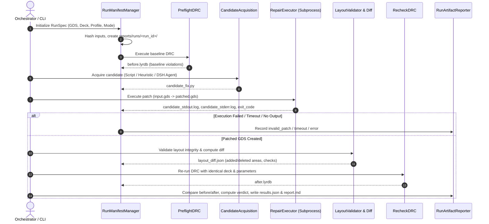

# ASAP7 DRC Agentic Repair: Staged Implementation Plan (Stages 0–D)

**Scope:** ASAP7 DRC Evaluation & Remediation Pipeline  
**Methodology:** Staged Architecture (Foundation 0, Phase A, Phase B, Phase C, and Separate Goal D)  
**Governing Documents:** `docs/ASAP7_Codex_Staged_Implementation_Package/`  
**Key Architectural Invariants:**
1. **Single-Shot Flow**: Implements `Fix → Apply Patch → Report` in an isolated out-of-process subprocess.
2. **Deterministic Orchestration**: Core single-shot evaluation engine implemented in Python (`src/klayout_drc/`). DeepSeek Harness (`harness/`) acts as the sole LLM caller in `mode=agent`.
3. **No Silent Fallback**: If an LLM call fails, the harness fails explicitly with `model_error`. Heuristic repair is only invoked when explicitly requested.
4. **Comprehensive Layout Validation**: Verifies top-cell identity, database unit (DBU) preservation, non-empty shapes, bounding box sanity, and layer-by-layer polygon diffs.
5. **Truthful Status**: Successful DRC runs without independent electrical verification are recorded as `success_geometry_only`.
6. **Isolated Run Bundles**: Every run outputs an immutable audit folder `reports/runs/<case_name>_<timestamp>_<short_id>/` with 10 artifacts including `results.json` and `report.md`.

---

## 1. High-Level Multi-Stage Roadmap (Stages 0 – D)

```mermaid
flowchart TD
    subgraph Stage0["Stage 0: Foundation (Fix → Apply → Report)"]
        F1["F0.1: RunSpec, RunManifest & Profiles"]
        F2["F0.2: Candidate Acquisition (Script, Heuristic, Agent)"]
        F3["F0.3: Out-of-Process Patch Executor"]
        F4["F0.4: Layout Validator & Polygon Diff"]
        F5["F0.5: Run Artifacts & Truthful Results Engine"]
        F6["F0.6: DSH Integration (Remove Silent Fallback)"]
    end

    subgraph StageA["Stage A: Small GDS & Mini DRC Proof"]
        A0["A0: Baseline Regression Lock"]
        A1["A1: 3-Way Proof (Script, Heuristic, Agent)"]
        A2["A2: Honest Fixture Suite (legacy_mini_v2)"]
        A3["A3: Comprehensive Negative & Failure Matrix"]
    end

    subgraph StageB["Stage B: Real Public ASAP7 DRC Migration"]
        B0["B0: OpenROAD ASAP7 Deck & Collateral Pinning"]
        B1["B1: Authentic ASAP7 Layer Map (M1=19/0, V1=21/0)"]
        B2["B2: XML-Wrapped DRC Macro Parser & Typed Rule Catalog"]
        B3["B3: Typed Numeric Geometry Markers & RDB Parser"]
        B4["B4: 5 Verified BEOL Rule Categories & Boundary Tests"]
    end

    subgraph StageC["Stage C: Expanded Benchmark Coverage"]
        C1["C1: Deterministic Seeded Mutation Generator (~100 cases)"]
        C2["C2: Standard-Cell & Hierarchy-Aware Context"]
        C3["C3: Routed OpenROAD Full Designs (DEF/ODB Context)"]
        C4["C4: Aggregate Evaluation & Benchmark Scoring"]
    end

    subgraph StageD["Stage D: Closed-Loop Agentic Repair (Separate Goal)"]
        D1["D1: Iterative Feedback Controller & State Machine"]
        D2["D2: Multi-Attempt Backtracking & Convergence Budget"]
    end

    Stage0 --> StageA
    StageA --> StageB
    StageB --> StageC
    StageB -. checker oracle .-> StageD
    StageC -. benchmark data .-> StageD
```

### Stage Summary & Scope

| Stage | Document | Scope & Goal | Key Deliverables |
|---|---|---|---|
| **Stage 0** | `01_Foundation_Fix_Apply_Patch_Report.md` | Common single-shot execution, verification, and audit substrate | Immutable inputs, `repair_executor.py`, `validator.py`, `layout_diff.py`, `run_manifest.py`, isolated `reports/runs/<run_id>/` |
| **Stage A** | `02_Phase_A_Current_Mini_GDS_and_Mini_DRC.md` | End-to-end proof on existing synthetic fixtures under explicit `legacy_mini` profile | Generator `create_legacy_mini_v2_fixtures.py`, tests for 8 case archetypes (A-W-1, A-S-1, etc.), 3-way evaluation reports |
| **Stage B** | `03_Phase_B_Real_ASAP7_DRC.md` | Authentic public ASAP7 technology mapping & KLayout `.lydrc` XML support | Real layer map (M1=19/0, V1=21/0), `rule_catalog.py`, typed marker parser, 5 verified BEOL rule families |
| **Stage C** | `04_Phase_C_Expanded_GDS_Coverage.md` | Scaled benchmark coverage and layout complexity | ~100 reproducible synthetic mutations, standard cell layouts, routed OpenROAD circuits, hierarchical window extraction |
| **Goal D** | `05_Separate_Goal_Closed_Loop_Repair.md` | Multi-attempt agentic closed loop (independent design) | Feedback controller, attempt history tree, convergence criteria, budget limits (3 attempts max) |

---

## 2. Detailed Implementation Plan: Stage 0 (Foundation)

Stage 0 establishes a single-shot `Fix → Apply Patch → Report` pipeline that guarantees:
1. Input files (GDS, DRC deck) are **strictly immutable**.
2. Generated patches are executed **out-of-process**.
3. Output layouts undergo **strict integrity validation**.
4. Every run produces an **isolated, reproducible audit bundle** in `reports/runs/<run_id>/`.

### F0.1: Baseline, RunSpec, RunManifest & DRC Profiles
- **File**: `src/klayout_drc/profile.py` (`DRCProfileManager`, `DRCProfile`)
  - Typed dataclass profile models (`legacy_mini`, `asap7_curated`, `asap7_public_full`).
  - Parameter mappings (`input/report` vs `in_gds/report_file`).
  - Layer mappings and database unit (DBU) values.
- **File**: `src/klayout_drc/run_manifest.py` (`RunManifestManager`, `RunSpec`)
  - Generates unique run directory `reports/runs/<case_name>_<timestamp>_<short_id>/`.
  - Computes SHA-256 hashes of input GDS and DRC script.
  - Captures tool versions, git commit, active profile.
  - Generates `run_manifest.json`.
- **Modifications**: `src/klayout_drc/runner.py`
  - Update `DRCRunner` to accept `DRCProfile` parameter mapping, ensuring deck arguments match the profile instead of hardcoded strings. Remove obsolete `.target.gds` fallback.

### F0.2: Single Candidate Acquisition & DSH Silent Fallback Removal
- Three explicit acquisition modes:
  1. `mode=script_file`: Reads a specified `.py` file path (for fast, offline regression tests).
  2. `mode=heuristic_baseline`: Runs `DRCFixer` to generate candidate repair code.
  3. `mode=agent`: Invokes DeepSeek Harness to synthesize `candidate_fix.py`.
- **DSH Update**: `harness/scripts/run-flow.mjs`
  - Remove silent fallback to the knowledge base recipe when LLM fails or API key is absent.
  - When LLM fails, exit with explicit error code (`1`) and structured error JSON (`{"status": "model_error", "message": "..."}`).

### F0.3: Out-of-Process Patch Executor
- **File**: `src/klayout_drc/repair_executor.py` (`RepairExecutor`)
  - Executes candidate script via Python subprocess: `python candidate_fix.py <input_gds> <output_gds>`.
  - Captures `stdout`, `stderr`, execution duration, and exit code.
  - Enforces execution timeout (`DEFAULT_TIMEOUT_SECONDS`, default 120s).
  - Verifies that `output_gds` exists and has non-zero file size.
  - Distinguishes failure states: `syntax_error`, `nonzero_exit`, `timeout`, `missing_output`.

### F0.4: Layout Integrity Validator & Polygon Diff
- **File**: `src/klayout_drc/validator.py` (`LayoutValidator`)
  - Inspects `patched.gds` with KLayout:
    1. Layout readability and non-empty shape count (rejects empty layouts).
    2. Top-cell matching (top cell name matches original input).
    3. Database unit (DBU) preservation.
    4. Bounding box sanity check (flags excessive expansion or zero-area collapse).
- **File**: `src/klayout_drc/layout_diff.py` (`LayoutDiffCalculator`)
  - Computes per-layer polygon differences between `input.gds` and `patched.gds`:
    - Area added ($\mu m^2$), area removed ($\mu m^2$), net area delta.
    - Modified layers list.
  - Produces `layout_diff.json`.

### F0.5: Run Artifact Materialization & Truthful Reporting
- **File**: `src/klayout_drc/run_reporter.py` (`RunReporter`)
  - Compares `before.lyrdb` and `after.lyrdb`.
  - Computes categorical violation delta:
    - Initial violations per rule, final violations per rule, delta count.
  - Assigns strongly-typed verdict:
    - `success_geometry_only`: Violations reduced to 0 and layout validation passed.
    - `partial`: Violations reduced but $> 0$.
    - `no_change`: Violation count unchanged.
    - `invalid_patch`: Execution failed, layout empty/corrupt, or violations increased.
    - `model_error`: LLM generation failed or returned unparseable content.
    - `timeout`: Subprocess exceeded timeout.
    - `drc_error`: DRC engine failed to execute or generate valid `.lyrdb`.
  - Materializes all files in `reports/runs/<run_id>/`:
    - `run_manifest.json`, `input.gds`, `before.lyrdb`, `candidate_fix.py`, `candidate_stdout.log`, `candidate_stderr.log`, `patched.gds`, `after.lyrdb`, `layout_diff.json`, `results.json`, `report.md`.

### F0.6: Orchestrator & Unified CLI
- **File**: `src/klayout_drc/single_shot.py` (`SingleShotOrchestrator`)
  - Chains the entire single-shot sequence: Preflight -> Candidate -> Executor -> Validator -> Recheck -> Reporter.
- **Modifications**: `src/klayout_drc/cli.py`
  - Add `--mode single-shot` to CLI supporting:
    - `--candidate-mode {script_file, heuristic, agent}`
    - `--candidate-script PATH` (for `script_file`)
    - `--profile {legacy_mini}`
    - `--run-id RUN_ID` (optional override)
    - `--json` (prints structured results JSON)

---

## 3. Detailed Implementation Plan: Stage A (Phase A - Small GDS & Mini DRC)

Stage A proves the Foundation on the existing small synthetic layout and mini DRC deck under the explicit profile `legacy_mini`.

### A0: Baseline Regression Lock
- Verify existing tests in `tests/test_drc_pipeline.py` pass without regression.
- Record baseline behavior: `test_data/layouts/asap7_test.gds` generates 8 violations (1 `M1_W`, 1 `M1_S`, 6 `V1_M1_ENC`) against `test_data/rules/asap7_mini.drc`.
- Ensure `asap7_test.gds` is never modified in-place.

### A1: Three-Way Demonstration
Demonstrate `single_shot` execution across all 3 source modes on `asap7_test.gds`:
1. **A1.1 Injected Known-Good Script (`mode=script_file`)**:
   - Provide a clean, verified repair script `tests/fixtures/known_good_mini_fix.py`.
   - Result: `success_geometry_only`, 0 remaining violations, all artifacts recorded.
2. **A1.2 Heuristic Baseline (`mode=heuristic`)**:
   - Run existing `DRCFixer` as candidate generator.
   - Result: `success_geometry_only`, 0 remaining violations.
3. **A1.3 Agent-Generated Script (`mode=agent`)**:
   - High-level orchestrator calls DSH to prompt LLM (`gpt-4o-mini` / `deepseek-coder`).
   - If API key is present: execute synthesized script, evaluate, and produce report.
   - If API key is absent: test records `BLOCKED` with truthful `model_error` verdict.

### A2: Versioned Honest Small-Fixture Suite (`legacy_mini_v2`)
- **Script**: `test_data/layouts/create_legacy_mini_v2_fixtures.py`
  - Generates deterministic, isolated GDS layouts for each targeted condition:
    | Case ID | File Name | Violation Condition | Expected DRC Before |
    |---|---|---|---|
    | `A-W-1` | `a_w_1_min_width.gds` | Isolated narrow M1 wire (10 nm width < 18 nm) | 1 `M1_W` |
    | `A-S-1` | `a_s_1_min_spacing.gds` | Two parallel M1 wires with 10 nm gap < 18 nm | 1 `M1_S` |
    | `A-E-1` | `a_e_1_via_enclosure.gds` | V1 with 2 nm M1 overhang < 9 nm | 1 `V1_M1_ENC` |
    | `A-OK-1` | `a_ok_1_clean.gds` | Perfectly DRC-clean layout | 0 violations (`no_change`) |
    | `A-MIX-1` | `a_mix_1_combined.gds` | Simultaneous width, spacing, and enclosure errors | 1 `M1_W`, 1 `M1_S`, 2 `V1_M1_ENC` |
    | `A-DBU-1` | `a_dbu_1_high_res.gds` | Same physical geometry created with `dbu=0.00025` | Equivalent violations |
- Fixtures committed to `test_data/layouts/legacy_mini_v2/`.

### A3: Comprehensive Failure & Negative Test Suite
- **Test File**: `tests/test_single_shot_pipeline.py`
  - Tests positive single-shot runs for A1.1, A1.2, A-W-1, A-S-1, A-E-1, A-OK-1.
  - Verifies presence of all 10 artifact files in `reports/runs/<run_id>/`.
- **Test File**: `tests/test_patch_failures.py`
  - Negative tests verifying fail-early behavior:
    | Negative Scenario | Simulated Patch Action | Expected Verdict |
    |---|---|---|
    | Syntax Error | `candidate_fix.py` has invalid Python syntax | `invalid_patch` |
    | Nonzero Exit | Script crashes with Python `RuntimeError` | `invalid_patch` |
    | Timeout | Script enters `while True: pass` loop | `timeout` |
    | Missing Output GDS | Script finishes but does not create `output_gds` | `invalid_patch` |
    | Delete-All / Empty Layout | Script wipes all top-cell shapes (`clear()`) | `invalid_patch` (failed validator) |
    | No-op Script | Script copies input to output without fixing | `no_change` |
    | Missing Deck / KLayout Error | Nonexistent DRC deck or corrupt deck file | `drc_error` |
    | Agent API Error | Simulated LLM HTTP 500 / missing API key | `model_error` |

---

## 4. File Inventory & Architecture

Strictly adhering to **One Primary Class Per File**:

| File Path | Primary Class / Function | Purpose |
|---|---|---|
| `src/klayout_drc/profile.py` | `DRCProfileManager`, `DRCProfile` | Typed dataclass profiles (`legacy_mini`, `asap7_curated`, etc.) |
| `src/klayout_drc/run_manifest.py` | `RunManifestManager`, `RunSpec` | Immutable input snapshots, hashing, run dir creation |
| `src/klayout_drc/repair_executor.py` | `RepairExecutor` | Out-of-process subprocess execution with timeout and log capture |
| `src/klayout_drc/validator.py` | `LayoutValidator` | Layout integrity verification (DBU, top cell, non-empty, bounding box) |
| `src/klayout_drc/layout_diff.py` | `LayoutDiffCalculator` | Per-layer polygon area and shape diffs (`layout_diff.json`) |
| `src/klayout_drc/run_reporter.py` | `RunReporter` | Compares `.lyrdb`, assigns typed verdicts, writes `report.md` / `results.json` |
| `src/klayout_drc/single_shot.py` | `SingleShotOrchestrator` | Orchestrates end-to-end single-shot execution sequence |
| `src/klayout_drc/cli.py` | `main()`, `run_single_shot_mode()` | CLI extension for `--mode single-shot` and candidate modes |
| `test_data/layouts/create_legacy_mini_v2_fixtures.py` | `generate_all_fixtures()` | Programmatic generator for versioned test cases A2 |
| `harness/scripts/run-flow.mjs` | Node script updates | Fix silent LLM fallback, export candidate script for Python engine |
| `tests/fixtures/known_good_mini_fix.py` | Script fixture | Clean known-good Python repair script for A1.1 test |
| `tests/test_single_shot_pipeline.py` | Integration tests | Tests positive single-shot flows and artifact generation |
| `tests/test_patch_failures.py` | Integration tests | Tests all negative, failure, and security rejection scenarios |

---

## 5. Implementation Stages & PR Boundaries

1. **PR 1: Foundation Execution & Reporting Substrate (F0.1, F0.3, F0.4, F0.5)**
   - Implement `profile.py`, `run_manifest.py`, `repair_executor.py`, `validator.py`, `layout_diff.py`, `run_reporter.py`.
   - Implement `SingleShotOrchestrator` and CLI `--mode single-shot --candidate-mode script_file`.
   - Unit and integration tests for isolated candidate execution and layout validation.
2. **PR 2: DSH Contract & Agent Integration (F0.2, F0.6)**
   - Update `harness/scripts/run-flow.mjs` to remove silent fallback and return typed status on failure.
   - Connect Python orchestrator's `--candidate-mode agent` to invoke DSH.
3. **PR 3: Phase A Fixture Generator & Honest Suite (A0, A2)**
   - Implement `create_legacy_mini_v2_fixtures.py` and commit generated layouts.
   - Implement baseline regression verification.
4. **PR 4: Phase A End-to-End Proof & Failure Matrix (A1, A3, A4)**
   - Implement `test_single_shot_pipeline.py` (A1.1, A1.2, and A1.3 if keys available).
   - Implement `test_patch_failures.py` (syntax errors, delete-all, timeout, no-op).
   - Update documentation (`README.md`, `GEMINI.md`).
