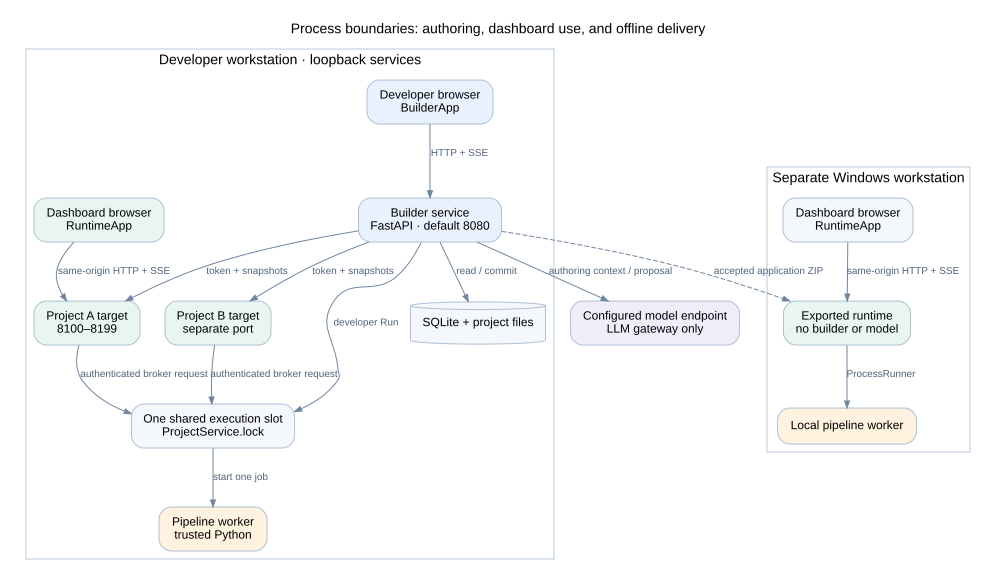
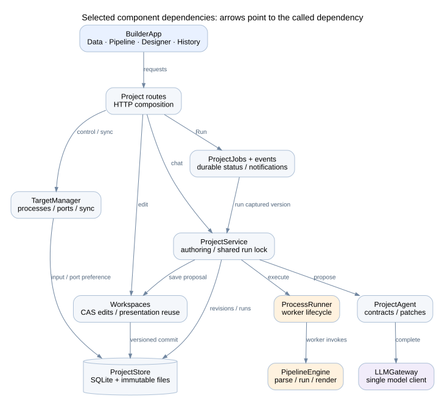

# System architecture

The builder is hosted through the Linux development path. Windows packaging and standalone dashboard execution use a separate runtime path.

## Process and deployment view

| Process or boundary | Entry point | Responsibility | Lifetime |
| --- | --- | --- | --- |
| Builder launcher | [launcher.py](../../launcher.py) | Optional CSV import; start the local builder and open its URL | Developer session |
| Builder HTTP service | [backend/app.py](../../backend/app.py) | Authoring APIs, persistence, job ownership, target control, export | Developer session |
| Builder browser | [BuilderApp.tsx](../../frontend/src/BuilderApp.tsx) | Chat, data, stages, design, history | Browser tab |
| One live target per project | [live_target.py](../../pipeline_core/live_target.py) | Model-independent dashboard state and same-origin runtime API | Owned by builder |
| Pipeline worker | [worker.py](../../pipeline_core/worker.py) | Execute one immutable pipeline request and serialize artifacts | One execution |
| Exported launcher/server | [runtime_launcher.py](../../runtime_launcher.py), [offline_app.py](../../offline_app.py) | Verify package; serve a saved dashboard; execute local workers | Standalone application session |
| Model endpoint | [llm_gateway.py](../../backend/services/llm_gateway.py) | Generate or refine project definitions | Called during authoring only |

The checked-in builder bind address is `0.0.0.0:8080`. The builder reserves exactly `server_port` (or `--port`) before importing startup data. If binding fails, it exits with an error; it never scans for another port. Live targets use distinct available ports in `8100–8199`, with a stored preferred port per project. The exported runtime requests port 8080 by default and can select another available port if occupied. Vite development uses port 3000 and proxies API traffic to the builder.

## Component view

The builder routes compose the store, workspace service, project service, durable jobs, and target manager. `ProjectService.lock` is the shared execution slot. The live target broker uses this same lock; it is not a separate distributed queue service. Each standalone offline application owns its own runner.

The common runtime is under `pipeline_core`. It does not import builder services, `config.py`, or the model gateway. Live and offline applications share `RuntimeApplication`, runtime HTTP routes, result contracts, and frontend dashboard components. Their execution adapters differ.

## Development-to-use flow

1. Import one CSV and explain its business meaning.
2. Chat proposes a workspace. Direct forms can edit supported properties.
3. Save development edits using an expected workspace version.
4. Select Run to compile and execute an exact revision, input, and parameter set.
5. Promote a successful complete result. Keep previous successful results when execution fails.
6. Apply successful developer updates to each target's current input and controls.
7. Accept an exact validated revision, then export it with a compatible Windows runtime.

A saved presentation edit can reuse complete artifacts without executing Python. A calculation edit stays pending until Run. A target-side Apply reruns saved logic; it does not contact the model or modify development history.

## Trust and service boundaries

The builder loads `OPENAI_API_KEY`. Target and worker processes receive a reduced environment without that key. Internal target control and execution requests use a per-target token. Target browsers call their own origin; they do not receive the internal token.

Generated Python is trusted application code. The worker has no bubblewrap, namespace sandbox, seccomp policy, or worker network guard. It has normal file and network access under the service account. Process separation, deadlines, memory limits, cancellation, and parent-exit cleanup remain. Configurable host checks, same-origin request checks, and the browser content policy protect the browser boundary; they do not sandbox Python. LAN clients share the same projects and service account. There is no user authentication.

Targets stop with the builder, including parent-pipe monitoring after a crash. A downloaded application runs independently. Shared remote hosting, user accounts, tenant isolation, and concurrent distributed workers are outside the current architecture.

## LAN access

The checked-in configuration binds builder and live target sockets to all IPv4 interfaces. `server_host` or `launcher.py --host` can select a specific interface or loopback. Host allowlists come from `allowed_hosts`; the default wildcard accepts a hosting machine's LAN addresses and DNS names. Internal loopback names are retained. Target status/control responses build dashboard URLs using the client's requested server host and the target's port. Internal broker URLs use the builder's bind address (loopback for a wildcard bind) and listening port, rather than the requested host name. The target's reduced bootstrap configuration receives the host allowlist but no model credentials. The offline adapter retains its default loopback policy.

Remote users access builder and targets on separate ports. Permit those ports through the host firewall. This is a direct HTTP deployment for trusted networks, without per-user permissions. Same-origin checks remain enabled; accepting LAN hosts does not enable cross-site requests.
