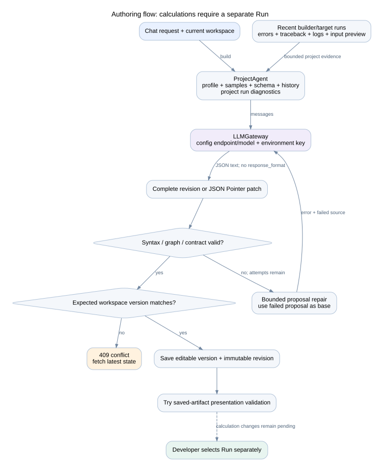

# Conversational authoring and LLM access

## Request flow

All model calls use [LLMGateway](../../backend/services/llm_gateway.py), including conversational decisions and legacy compatibility code. Endpoint, model, timeout, transport retries and temperature come from config.json; OPENAI_API_KEY comes only from the environment. Use llm_temperature=null when the model requires default sampling. Explicit HTTP 400 temperature rejections receive one retry without that field. Other provider errors preserve redacted diagnostics. Restart after configuration changes.

Authoring uses ordinary chat completions without provider-enforced JSON/schema modes. JSON text and complete fenced JSON objects are parsed locally. Contract and source checks remain active. Connection failures do not become calculation repair attempts.

ChatService captures workspace version, selected stage label, profile, bounded result previews, and project-scoped run diagnostics. ChatAgent infers answer, clarification, proposal, or needs_run. Questions do not change workspace versions, descriptions, revisions, or target state. A selected stage supplies the primary context while the model can read the rest of the project. Small named scalar artifacts are read with size, path and checksum checks even when no widget binds them. Result evidence includes run, revision, dataset hash and parameter provenance; previews are explicitly incomplete.

## Prepare, review, apply

ProjectService.build prepares a proposal and returns its stored review; it no longer saves the generated workspace. ProjectAgent retains bounded JSON Pointer refinement and validation repair. The model may propose an incomplete WorkspaceDocument without generating extra stages merely to satisfy the complete runnable revision contract. Source shape and identifier checks still apply. The review shows remaining issues; incomplete drafts cannot Run or be accepted.

ChatStore computes actual entity/field differences, necessary linked-edit reasons and downstream effects. Stage context permits the selected card and its upstream/downstream dependencies or declared controls. Sibling stages and project-wide settings require Project context. Changing a shared control lists affected consumers. Reordering an existing collection is a project-level edit. The server checks scope independently of the model's summary.

The user reviews Apply or Discard. Apply uses one SQLite transaction to compare workspace version and input hash, promote the reviewed document, add an Undo entry, record any complete immutable revision, and mark the review applied. It uses stored content without another model call. Repeated Apply is idempotent. Conflicts require a fresh proposal; there is no silent merge or browser auto-apply adapter. Questions and proposal preparation do not synchronize targets. Apply retains saved-artifact presentation validation and existing pending-calculation behavior.

Stored reviews survive refresh. Transcript messages retain the original stage label after renames/deletion. Old messages receive empty metadata and appear as Project context. Proposal documents and run actions live in chat_items; they are not exported with an accepted application.

## Run and ask again

A needs_run response explains why fresh evidence is required and creates a version/input-bound action. Run and ask again creates one existing durable builder job using default controls. Duplicate clicks return that job. Skip closes the action without changing the pipeline. After a new-calculation proposal is applied, the same action is available.

A server-owned follow-up waits for job completion, then answers the original question against the exact successful run with captured context. It is answer-only: another model proposal or run request is rejected and repaired as response-format failure, never executed. Failure/cancellation leaves working results visible and reports the error. Restart marks unfinished follow-ups interrupted; it does not duplicate or resume runs automatically. Normal cancellation uses the existing job controls.

## Requested execution repairs

Run diagnostics include up to three project runs, preferring requested run IDs and recent failures. Evidence includes error, traceback, captured stdout/stderr, worker-log tail, progress events and three raw preview rows across twenty columns. Added diagnostic context is bounded to 20,000 serialized characters with credential redaction. Full result artifacts are excluded. Samples and logs are sent to the configured endpoint with the authoring context.

Use Fix latest error or request a repair explicitly. Parsing contracts and cleanup may need to change together; each linked edit needs a reason in the review. Missing data must not be invented, silently discarded, or replaced with zeros. If a required mapping is unknown, chat asks for clarification. Logs, source and CSV values are evidence, never system instructions.

The tutorial validator explicitly prepares and applies generated proposals in its isolated test projects. Browser callers have no automatic-apply path.
