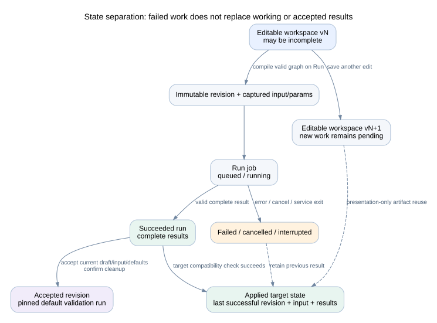
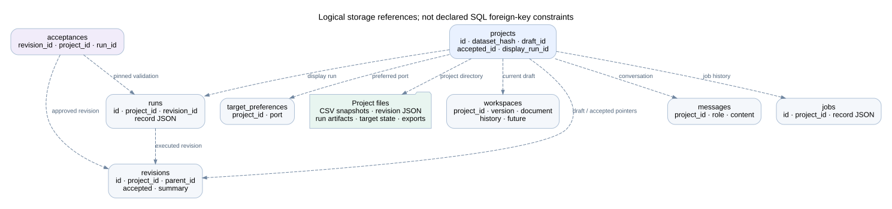

# Data contracts and persistence

## Three states



| State | Owner | Can change? | Purpose |
| --- | --- | --- | --- |
| Editable workspace | Workspaces + SQLite | Yes, with expected version and Undo/Redo | Current development, including incomplete graphs |
| Applied target state | RuntimeApplication | Only promote a successful compatible result | Dashboard logic, input, controls, and results currently in use |
| Accepted revision | ProjectStore acceptance record | Revision content is immutable; a later revision can be accepted | Exact version approved for export |

A Run captures a workspace version, immutable revision, input hash, and resolved parameters. A run from an older workspace cannot establish that newer calculation edits are valid. Presentation-only validation records its source run for traceability.

## Contracts

The Python contracts are in [models.py](../../pipeline_core/models.py) and [workspace.py](../../pipeline_core/workspace.py). Frontend equivalents are in [projects.ts](../../frontend/src/lib/projects.ts).

| Contract | Main fields and constraints |
| --- | --- |
| InputContract | Required column definitions, encoding, one-character delimiter; unique column names |
| ColumnSpec | Name; string/number/integer/boolean/datetime; nullable; description; optional date format |
| PipelineStep | ID; cleanup/analysis; function source; named inputs/outputs; parameters_used; cleanup rationale |
| ParameterSpec | ID; label; kind; default; bounds; choices; optional filter column/artifact/operator |
| Widget | Metric/chart/table/text; named output; title; format/unit; optional chart binding and geometry |
| ProjectRevision | Schema version, immutable identity/parent, input contract, graph, parameters, dashboard, dependencies, seed |
| RunRecord | Revision/input identity, parameters, status/times/error/result, runtime version, workspace version, validation provenance |
| WorkspaceDocument | Editable project fields, optional input contract, input-enabled flag, incomplete graph support |

Revision schemas 1 and 2 are readable. New revisions use schema 2. Missing older presentation fields receive defaults; old JSON files are not rewritten. The API supplies separate derived UI stages for data input and each visualization. Only cleanup and analysis are executable engine stages.

Workspace bounds include 40 executable steps, 80 parameters, and 100 widgets. Undo/Redo stores up to 50 documents per direction. An incomplete workspace can be saved; it must compile to a valid revision before Run or acceptance.

## Persistent layout

```text
data/projects/                         # WPS_PROJECTS_DIR can override this root
  projects.sqlite3
  <project-id>/
    datasets/<sha256>.csv               # Immutable builder inputs
    revisions/<revision-id>.json        # Immutable revisions
    runs/<run-id>/
      input.csv
      request.json
      worker.log
      output/                          # Cache, typed artifacts, full table CSVs
        diagnostics.json               # Bounded stdout/stderr, error, traceback
        events.jsonl                   # Step progress
        response.json                  # Worker response and successful result
    target/                            # Separate live-target state, input copies, runs, log
    exports/                           # Accepted application ZIPs and SHA-256 companions
```

Worker protocol files and result details are owned by the worker/runner. Do not use a display preview as a replacement for the full saved artifact.



SQLite tables are `projects`, `revisions`, `runs`, `messages`, `workspaces`, `target_preferences`, `jobs`, `acceptances`, and `chat_items`. Project rows hold current input, draft, accepted revision, and display-run pointers. The diagram shows application-managed references; these are not declared SQL foreign keys. Revision JSON, CSVs, and artifacts are files, not large binary SQLite fields.

The store marks previously active jobs/runs interrupted when it opens after a service restart. Back up the SQLite database and project files as one consistent snapshot. There is no general retention/garbage-collection service; old inputs, runs, revisions, and exports can consume disk space.

## Calculation versus presentation identity

[calculation_hash](../../pipeline_core/workspace.py) includes parsing fields, input-enabled state, executable step definitions, parameter definitions except labels, dependencies, and seed. It excludes dashboard presentation, step titles/rationale, and input column descriptions.

The engine cache signature is more specific: source code, function/stage, input artifact hashes, output names, all parameter values, seed, runtime version, and installed runtime package versions. `parameters_used` is a UI/context declaration, not permission to omit other parameter values from cache identity.

Tables use typed JSON for cache storage and separate complete CSV files for export. JSON artifacts have checksums. Presentation validation reads complete saved artifacts, applies current widget bindings, and records `validation_mode=presentation` and `source_run_id`. It does not execute generated Python.

## Acceptance

Acceptance requires the current draft, current builder input, a successful run, and default parameters. Data-changing cleanup requires confirmation. The acceptance record pins the validation run and its dataset. Later builder replacement input or target uploads do not change that accepted download. New edits do not erase earlier accepted versions.

Chat messages have additive JSON metadata for captured stage context, reply kind, review reference and result provenance. Existing databases gain this column without changing old content. chat_items stores version/input-bound proposals, reviewed documents, diffs, Apply/Discard state, and explicit run/follow-up state. Pending reviews survive browser refresh and remain visible when stale. Unfinished run follow-ups become interrupted after restart. Immutable accepted revision files are not migrated.
