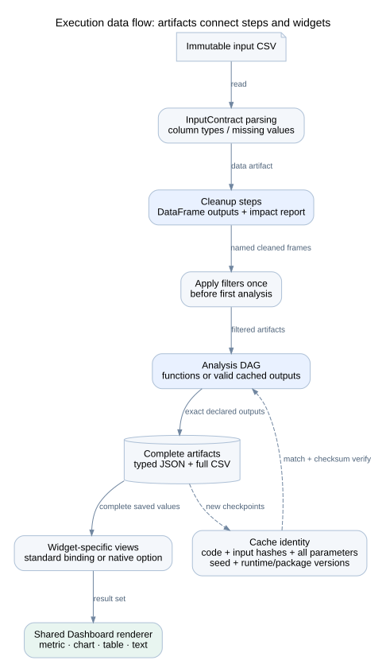

# Execution engine and worker

## Data flow



| Component | Responsibility | Dependencies |
| --- | --- | --- |
| [validation.py](../../pipeline_core/validation.py) | Source shape, reproducibility rules, graph order, parameter validation | Python AST, model contracts |
| [ProcessRunner](../../pipeline_core/process_runner.py) | Input snapshot; request files; subprocess; events; deadline/cancel; resource and parent handling | Worker protocol, standard process APIs, Windows Job Objects on Windows |
| [worker.py](../../pipeline_core/worker.py) | Read request, set limits/monitor parent, run engine, return response | PipelineEngine, models, package versions |
| [PipelineEngine](../../pipeline_core/engine.py) | Parse input, order steps, filter, execute/reuse, serialize artifacts, render widget views | pandas, NumPy, models, validation |
| [statistics.py](../../pipeline_core/statistics.py) | Portable forecast helper and chronological validation | pandas, NumPy, statsmodels |

## Step contract

```python
def function(inputs, parameters, context):
    df = inputs['cleaned'].copy()
    result = float(df['amount'].sum()) * parameters['multiplier']
    return {'total': result}
```

Declare `inputs=['cleaned']` and `outputs=['total']` on the step. The mapping must contain exactly those output names. `pd` and `np` are preloaded; every other module/helper must be explicitly imported in saved source. Return a DataFrame from each cleanup output. Use unique public Python identifiers for output names; do not replace reserved `data`.

Each function has three arguments. DataFrame inputs are copied before invocation. Steps must use explicit seeds and source/saved dates rather than the system clock. These checks support repeatability; they do not prove that arbitrary Python is deterministic or safe.

## Order, filters, and controls

The engine orders a directed acyclic graph by available named inputs. It rejects cycles, missing inputs, repeated outputs, and cleanup that depends on analysis. Cleanup runs before analysis.

Filters apply once, immediately before the first analysis step. A filter references `data` or a named cleanup DataFrame and a real column. Supported operators are equality, greater-or-equal, less-or-equal, and literal substring contains. Null means All. Control choices from data are limited to the first 200 distinct non-null values; this is not a complete large-category browser.

Scenarios have no filter column. Python uses their values explicitly, for example a fixed-quantity discount multiplier. Number/integer controls require finite values and enforce bounds; boolean and string types are checked. Unknown parameter keys are rejected. Defaults are merged with supplied values before execution.

## Reuse and output rules

A matching checkpoint loads typed artifacts only after checking their paths and hashes. A changed input artifact or calculation invalidates dependent work. All supplied parameter values participate in each step signature, so changing one control can reduce cache reuse even for a step whose `parameters_used` is smaller.

The engine writes full DataFrames, then creates display previews of up to 500 rows. Table column names must be unique strings. Charts have a separate widget-specific view, allowing one DataFrame to back both a chart and a table. Chart series/datasets are limited to 5000 items; saved code must explicitly aggregate or sample larger inputs.

Cleanup reports before/after row counts, missing cells, added/removed columns, and changed cells when row indexes allow comparison. Ambiguous indexes limit cell-level change comparison. A rationale and confirmation flag explain changes in analytical meaning.

## Concurrency and failure

The builder's project service and live-target broker share one asyncio execution lock. Waiting requests queue for this slot; there is no multi-worker scheduler. Durable builder job metadata survives a browser disconnect, but it is not automatically resumed after a builder restart. Status becomes interrupted.

`ProcessRunner` defaults to a 120-second deadline and 4 GiB memory limit. These constructor defaults are used by active project execution; do not assume changing a legacy config field changes every runner instance. Cancellation stops the process group or closes its Windows job. Parent monitors stop orphan workers.

A failed or cancelled result does not replace the successful display result. Inspect the run error, job events, and `worker.log`. The worker also writes `output/diagnostics.json`, separate from large result artifacts. It contains captured stdout/stderr on success or failure, plus the error and traceback on failure. Chat receives bounded portions of these files for requested repairs. A traceback or source-validation error is diagnostic data, not an instruction to execute additional code outside the saved pipeline.

## Forecast helper

`forecast(series, horizon=12, method='exponential_smoothing', season_length=None)` accepts `naive`, `arima`, or `exponential_smoothing`. Horizon is 1–365. At least ten finite numeric observations are required after missing values are dropped. For a datetime index, order, uniqueness, and equal spacing are checked. A plain numeric index does not establish calendar spacing; supply a proper datetime index for date forecasts.

Holdout size is `max(2, min(horizon, n // 5))`. The helper fits on the earlier observations and scores the trailing holdout with MAE. Its naive baseline repeats the last training value. It then refits on all current observations for the future forecast.

ARIMA uses order `(1,1,0)` and returns 95% model intervals. Exponential smoothing uses an additive trend and optional additive seasonality; season_length requires at least three full seasons. Naive and exponential smoothing do not return calibrated intervals from this helper. Return fields include forecast, prediction_intervals_95, backtest_mae, baseline_mae, training/holdout counts, method, assumptions, and uncertainty. Future dates and chart options are the saved step's responsibility.
