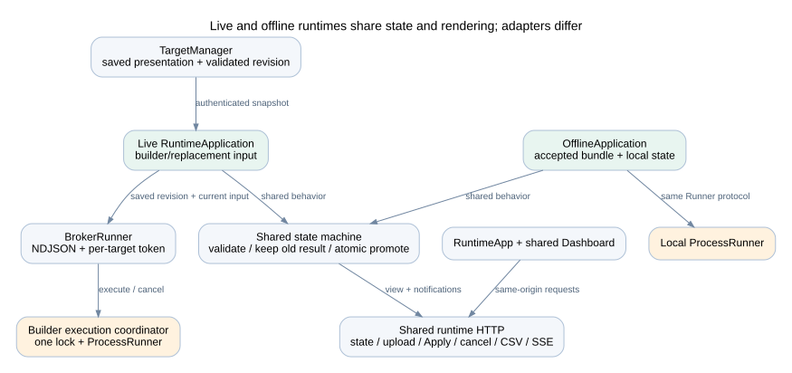

# Live and offline dashboard runtime

## Shared runtime and adapters

| Component | Owns | Dependencies |
| --- | --- | --- |
| TargetManager | Port reservation, child process/token, snapshots, status/start/stop/restart | Store, Workspaces, subprocess/socket APIs, httpx |
| BrokerRunner | Authenticated execution/cancel stream to builder | httpx, runner protocol, project revision |
| RuntimeApplication | Current/desired revision, input mode, result promotion, persisted state, notifications | Runner protocol, models, validation, saved rendering |
| create_runtime_app | Same-origin runtime routes and static assets | FastAPI, shared application, browser policy |
| OfflineApplication | Load and verify accepted bundle; select local state/input | Bundle loader, RuntimeApplication |

The live target is started with a reserved listening socket and bootstrap settings through its parent-owned input pipe. The manager tries the preferred port first, then the configured range. The target stays open when the developer switches projects. Its parent watcher exits when the builder pipe closes.

The target has no model configuration or agent routes. Its broker executes saved revisions in the builder worker slot. The offline adapter uses ProcessRunner directly and does not require a broker, target token, model, or builder process.

## Update behavior

| Change | Runtime response |
| --- | --- |
| Title, number format, unit label, layout | Save presentation and validate against complete artifacts |
| Standard chart binding | Re-render only if saved columns/types are compatible |
| New widget without output | Pending placeholder |
| Calculation, input contract, default, builder CSV | Mark pending; developer Run required |
| Successful developer Run | Attempt candidate revision against target input and controls |
| Incompatible target input or failed candidate | Keep previous working revision/input/results and report error |
| Target control form edit | No calculation until Apply |
| Target CSV upload | Validate and execute candidate input in separate target state |
| Use builder data | Execute builder input with revision defaults and switch input mode on success |

The runtime uses a lock to prevent overlapping state promotion. The desired revision can differ from the applied revision after an update fails. Snapshot identity prevents an older in-flight update from overwriting a newer developer update. A full result is promoted atomically; widgets do not independently switch to values from different runs.

A target starts in builder-input mode. A successful target upload changes its mode to replacement. It does not replace the builder CSV or accepted input. Upload and Use builder data execute with defaults; do not assume the prior temporary control values are retained for those actions. A developer update attempts to preserve valid existing controls and reports resets for removed or invalid controls.

## Events and reconnects

Project events and runtime events are server-sent event streams. They send small change notifications with sequence IDs and heartbeat comments. Clients fetch fresh state on connection/change. Runtime state includes a process instance ID so a new process sequence is distinguishable from an old one.

Event streams are not a durable event log and do not replay every missed business event. Builder notifications coalesce; runtime detail is bounded. Reconnect by reading authoritative current state, not by repeating the last Run request. Keep visible successful results during connection loss.

## Persistence and shutdown

Live runtime files are under the project's `target` directory. `state.json` is replaced through a temporary file. Inputs are copied to content-addressed files. Each runtime run has its own artifact directory. Target logs are in `target/server.log`.

The offline state default is `%LOCALAPPDATA%/WPSAnalysis/<revision_id>` on Windows; `--state-dir` overrides it. Runtime state is outside the immutable exported package. Startup clears interrupted active-run status and keeps the last successful display result.

The builder closes targets and workers on shutdown. Target server shutdown has a bounded grace period, so an open event stream cannot hold it indefinitely. An offline app has its own lifecycle and does not stop when the original builder exits.
