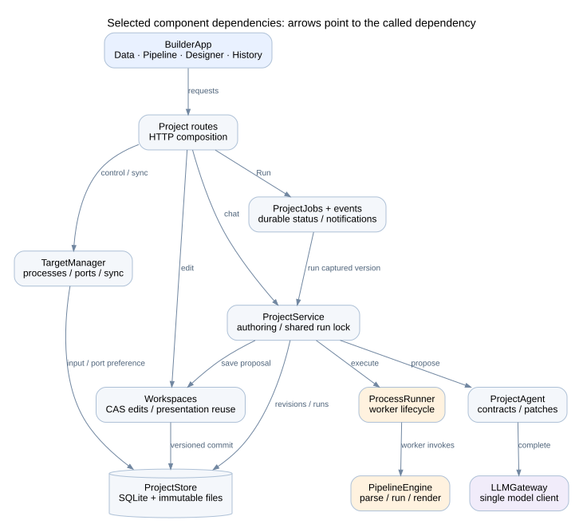

# Component and package dependencies

## Dependency direction

An arrow means the source component calls or imports the target for the labelled responsibility. The graph is selective. [inventory.json](inventory.json) contains static internal Python import edges for the inspected modules. Static imports include optional/compatibility paths and cannot prove that a module is invoked on every request.

| Component | Internal dependencies | External/runtime dependencies | Used by |
| --- | --- | --- | --- |
| CSV import/profile | ProjectStore, Workspaces, profile models | pandas, NumPy | Launcher, project upload API |
| ProjectStore | Models, fingerprint helper | sqlite3 and local filesystem | Workspace, authoring, jobs, targets, export |
| Workspaces | Store, WorkspaceDocument, validation, saved renderer | Pydantic, SQLite | Forms, agent proposals, jobs, target snapshots |
| LLMGateway | AppConfig, domain errors | OpenAI-compatible client | ProjectAgent and legacy AgentService |
| ProjectAgent | LLMGateway, model_output parser, ProjectRevision, patch logic | JSON, Pydantic | ProjectService.build |
| Run diagnostics | Store, credential redaction | pandas, JSON, bounded project file reads | ProjectService.build |
| ProjectService | Store, Agent, Workspaces, ProcessRunner, run diagnostics | asyncio/threading | Routes, ProjectJobs, shared broker lock |
| ProjectJobs/events | Store, Service, TargetManager, Workspaces | asyncio queues/tasks | Version-bound Run and project notifications |
| TargetManager | Store, Workspaces, runtime snapshot helpers | subprocess/socket, httpx | Project routes and builder lifespan |
| BrokerRunner | Revision and runner interface | httpx NDJSON stream | Live target RuntimeApplication |
| RuntimeApplication | Models, validation, saved renderer, Runner | asyncio, filesystem | Live target and OfflineApplication |
| ProcessRunner/worker | Engine, models, package version snapshot | OS subprocess APIs; Windows Job Objects | Builder coordinator and offline adapter |
| PipelineEngine | Models, validation, serialization | pandas, NumPy; explicitly imported numerical libraries | Worker |
| ExportService/bundle | Store, models, inventory/version helpers | ZIP/filesystem/hash APIs | Builder export and offline verification |
| BuilderApp | StageCanvas, PropertiesPanel, Dashboard, settings/profile UI | React, icons, HTTP/EventSource | Builder browser entry |
| RuntimeApp | Dashboard, DashboardControls, runtime API types | React, HTTP/EventSource | Target/offline browser entry |
| Dashboard | ChartViewer, DataTableViewer, shared contracts | React Grid Layout | Both browser entry points |
| ChartViewer/export | Chart contract, chartExport | ECharts; browser SVG/canvas APIs | Dashboard |
| Tutorial tools | Builder services, public-data preparation and checks | openpyxl for preparation; pandas/SciPy/statsmodels; local ECharts | Tutorial pack build/validation only |

## Package groups

The table below records declared direct dependency requirements, not the exact versions installed on this host. The generated inventory reads `pyproject.toml` and `frontend/package.json`.

<!-- PACKAGE_TABLES -->

| Group | Declared package requirement |
| --- | --- |
| Python application | `fastapi>=0.115.0` |
| Python application | `uvicorn[standard]>=0.30.0` |
| Python application | `pandas>=2.2.0` |
| Python application | `numpy>=1.26.0` |
| Python application | `scipy>=1.13.0` |
| Python application | `statsmodels>=0.14.2` |
| Python application | `pydantic>=2.8.0` |
| Python application | `httpx>=0.27.0` |
| Python application | `openai>=1.40.0` |
| Python application | `sse-starlette>=2.1.0` |
| Python application | `python-multipart>=0.0.9` |
| Python optional: dev | `pytest>=8.3.0` |
| Python optional: dev | `pytest-asyncio>=0.23.0` |
| Python optional: dev | `mypy>=1.11.0` |
| Python optional: dev | `pandas-stubs>=2.2.0` |
| Python optional: packaging | `pyinstaller>=6.10.0` |
| Python optional: tutorials | `openpyxl>=3.1.5` |
| Frontend | `@assistant-ui/react` `^0.15.18` |
| Frontend | `clsx` `^2.1.1` |
| Frontend | `echarts` `^6.1.0` |
| Frontend | `lucide-react` `^1.43.0` |
| Frontend | `react` `^19.2.8` |
| Frontend | `react-dom` `^19.2.8` |
| Frontend | `react-grid-layout` `2.3.0` |
| Frontend | `recharts` `^3.10.1` |
| Frontend | `tailwind-merge` `^3.6.0` |
| Frontend build/dev | `@types/react` `^19.0.0` |
| Frontend build/dev | `@types/react-dom` `^19.0.0` |
| Frontend build/dev | `@vitejs/plugin-react` `^4.3.1` |
| Frontend build/dev | `autoprefixer` `^10.4.20` |
| Frontend build/dev | `postcss` `^8.4.47` |
| Frontend build/dev | `tailwindcss` `^3.4.14` |
| Frontend build/dev | `typescript` `^5.6.3` |
| Frontend build/dev | `vite` `^5.4.10` |

<!-- END_PACKAGE_TABLES -->

FastAPI, Uvicorn, Pydantic, multipart handling, pandas, NumPy, SciPy, and statsmodels are shared runtime concerns. httpx supports builder/target communication. OpenAI SDK and sse-starlette support builder authoring/streams. PyInstaller is a Windows build tool. openpyxl is only needed to regenerate the retail tutorial input from Excel.

React, React DOM, ECharts, React Grid Layout, and lucide-react are used by the active UI. Some declared frontend packages, including assistant-ui and Recharts, remain from other/legacy UI work; they are not the chart engine or chat shell used by the active builder entry point. Do not infer active use from package.json alone.

Vite, TypeScript, Tailwind/PostCSS, and React type packages support frontend development/builds. Node and pnpm are build tools; the exported dashboard does not require them on the target workstation.

## Version authorities

| File or function | Purpose |
| --- | --- |
| pyproject.toml | Python direct dependency ranges and optional groups |
| uv.lock | Resolved Python environment lock |
| requirements-runtime.txt | Exact shared numerical/runtime release pins |
| frontend/package.json | Frontend direct dependency declarations |
| frontend/pnpm-lock.yaml | pnpm resolution used by documented frontend builds |
| pipeline_core.__init__ | Shared runtime version and ABI constants |
| bundle.installed_versions | Actual runtime package versions and Python major/minor used for cache/export compatibility |
| tutorials/validation.json | Package/model snapshot for completed tutorial validation, not a release lock |

The permissive project ranges and an existing local environment can differ from the pinned runtime release file. Export compares the actual builder versions against the Windows archive. A matching ABI alone is insufficient. Install the intended shared release in both environments and rebuild the archive when required; do not edit metadata to bypass the comparison.

## Runtime exclusions

The packaged runtime is model-independent. It needs no model key, OpenAI service, builder routes, Node, package manager, or tutorial data tooling. A numerical dependency named in a revision is limited to the supported package contract. This is distinct from code sandboxing: trusted Python is not technically restricted to an import allowlist, but an undeployed package cannot be assumed to exist in an exported application.
