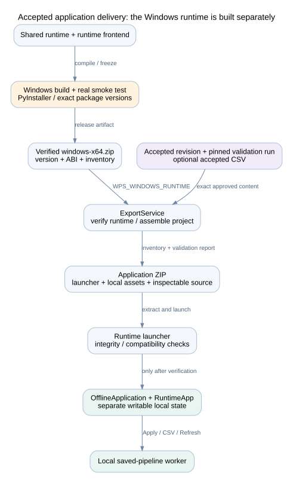

# Build, operations, and extension guide

## Build the Linux builder

Use the supported Python 3.12 build/release environment. The project metadata currently permits Python 3.11 or later, but that range does not establish Windows release verification for every interpreter version.

```bash
uv venv --python 3.12
uv pip install -r requirements-runtime.txt
uv pip install -e '.[dev]'
cd frontend
pnpm install --frozen-lockfile
pnpm exec tsc --noEmit
pnpm exec vite build
pnpm exec vite build --mode runtime
cd ..
```

Run the launcher from the project root.

```bash
python launcher.py
python launcher.py --headless --csv /absolute/path/input.csv
```

Each `--csv` launch creates a new project, profiles a copied CSV, and selects its Data view. It does not call the model or execute calculations.

## Configuration and storage

| Setting | Effect |
| --- | --- |
| config.json model settings | Endpoint/model/request behavior through the single gateway |
| OPENAI_API_KEY | Builder model credential; not a config-file key |
| WPS_PROJECTS_DIR | Builder project-store root |
| WPS_TARGET_PORT_START / WPS_TARGET_PORT_END | Inclusive target port range |
| WPS_WINDOWS_RUNTIME | Verified compatible Windows runtime ZIP for export |
| Runtime --port | Requested local dashboard port |
| Runtime --state-dir | Separate writable runtime state directory |
| Runtime --headless / --verify | Skip browser launch / verify package and exit |

The builder serves `backend/static`; the live target serves `runtime_static`. Runtime packaging copies the runtime frontend into package `static`. Rebuild both frontend modes after changing shared renderer code.

## Windows export flow



On Windows 11 x64, install the shared runtime pins plus development/packaging tools, build the frontend, and run `scripts/build_windows_runtime.py` and `scripts/windows_smoke.py`. Configure the resulting verified archive in the builder. See [README.md](../../README.md) for the full command sequence and CI workflow locations.

Export requires an accepted revision and a successful default-parameter validation run. It checks archive paths/size, platform, version, ABI, runtime package versions, file inventory, executable, and frontend. It then adds revision JSON, inspectable step Python, the accepted CSV when requested, validation provenance, instructions, and a complete inventory. Target replacement files, temporary controls, model credentials, and chat history are excluded.

The exported launcher verifies integrity and compatibility before serving the saved application. Hashes detect modification; they are not an author signature. Updating saved logic requires a new builder export. Runtime state stays outside the package.

A real compatible Windows archive is unavailable in this development environment. Linux checks and missing-runtime error tests do not replace a real frozen Windows smoke test or a clean-machine test with external networking blocked.

## Verification commands

```bash
python -m pytest tests/ -q
python -m mypy pipeline_core backend config.py offline_app.py runtime_launcher.py
python scripts/studio_smoke.py
python scripts/build_developer_docs.py
```

Run the frontend checks/builds above when UI code changes. `studio_smoke.py` uses temporary projects and real local processes without model calls. It checks separate ports, manual Run, presentation updates, deletion/Undo, input isolation, failure recovery, credential exclusion, restart/shutdown, and parent-crash cleanup.

| Change | Main checks |
| --- | --- |
| Agent patch/schema behavior | test_project_agent.py, test_projects.py; optional explicit real-model validation |
| Workspace/version/deletion | test_workspaces.py, test_projects.py, studio_smoke.py |
| CSV import/startup | test_startup_csv.py, test_data_profiler.py |
| Engine/output/cache/forecast | test_pipeline_engine.py; independent known-answer inputs |
| Runtime API/input/retention | test_offline_app.py, test_projects.py, studio_smoke.py |
| Single LLM entry/config | test_llm_gateway.py |
| Tutorial artifacts | test_tutorials.py; explicit tutorial_validate.py --live-model |
| Windows package | Real Windows build, windows_smoke.py, clean-machine offline exercise |

The existing legacy test files cover compatibility code too. A mock-model test verifies orchestration, not model generation quality. Live tutorial validation uses API tokens and isolated tutorial projects; do not run it as an implicit documentation build step.

## Extension recipes

### Add a standard binding chart

Update ChartBinding in Python and the matching frontend type, frame-to-chart rendering, Properties choices, source validation as required, and known-answer tests. Verify saved-artifact presentation updates and all three rendering contexts. A native ECharts option that works through chat does not automatically create a new standard binding kind.

### Add an analysis helper

Put model-independent numerical code under pipeline_core. Define input, output, missing-data, ordering, and parameter rules. Add independent numerical/edge-case tests. Describe the helper in the agent context so generated code imports and uses it correctly. If it needs another dependency, include that dependency in the shared release, version checks, and Windows build before advertising support.

### Change a revision contract

Update Python contracts, frontend types, compatibility/default loading, workspace compilation, cache/calculation identity, and package handling. Keep old immutable revision files unchanged. Decide whether runtime version/ABI must change, then rebuild the Windows archive and test old/new behavior.

### Add a project API

Keep route handlers thin. Put persistence and state changes in the owning service. Require expected_version for workspace mutations; publish an event after a committed change and synchronize the target where needed. Do not make browser disconnection cancel a durable workspace job. Keep agent routes out of create_runtime_app.

## Automatic frontend preparation

`launcher.py` reserves the configured server port, then calls `backend/services/frontend_build.py` before importing startup data or starting the server. The helper hashes frontend sources, package declarations, and the lockfile, excluding dependency/build directories. It also hashes both output trees. Missing or changed outputs rebuild both bundles. A missing or changed dependency stamp runs `pnpm install --frozen-lockfile` first.

Successful builds write `runtime_cache/frontend-build.json`; dependency state is stored under `frontend/node_modules`. Both locations are ignored by Git. A failed command invalidates the build stamp and stops startup. If source changes during a build, startup stops and asks for another launch. Unchanged verified bundles require no build tools at startup. Update Git separately, then restart; the launcher never pulls or merges Git changes.

## Troubleshooting

| Symptom | Inspect | Next action |
| --- | --- | --- |
| Model request fails | Gateway error, endpoint/model/output mode, key presence | Correct config/environment; do not print the key |
| Workspace conflict | Expected version versus latest workspace | Fetch state and reapply the intended edit |
| Pending cards | Workspace issues, current run/job | Complete graph and select Run |
| Worker fails | Job error, run worker.log, request and declared outputs | Repair saved logic; run the same known input again |
| Target retains older revision | Target last_error, input mode, source revision/input | Repair compatibility or return to builder data |
| No target port | Target log, occupied range, preferred port | Change range or release an occupied port |
| Export rejected | Accepted validation identity; archive version/ABI/package versions | Build/provide a compatible verified runtime |
| Table download seems short | Preview count versus exported file row count | Use full CSV export, not copied preview rows |

## Documentation build

The documentation builder uses the Python standard library and Graphviz `dot`. It does not import backend.app, initialize a project store, read the API key, call the model, start workers, or change user projects. Rebuild after changing routes, package declarations, or diagram sources. Inspect the diagrams and review architecture prose; automated extraction cannot prove that prose is correct.
