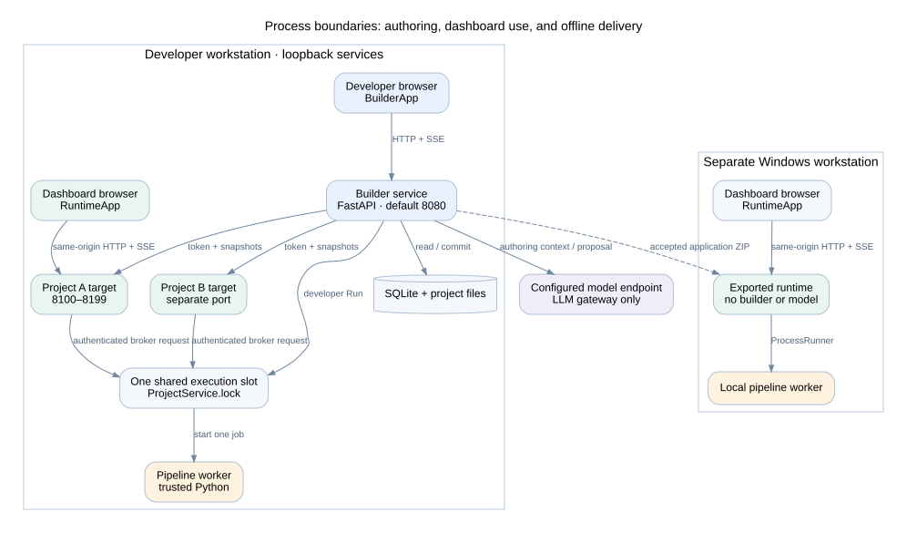

# Developer handbook

This handbook describes the implemented WPS-AI Data Analysis Studio. It covers the builder, saved pipelines, live project dashboards, and exported Windows applications. Read it with the source tree from the same checkout.

Reviewed on 2026-11-04. Runtime version: **0.3.1**. Runtime ABI: **2**. New project revisions use schema **2**; schema 1 revisions remain readable. This is an implementation guide, not a promise that every possible model-generated application will work without repair.

## Reading order

| Document | Main question |
| --- | --- |
| [System architecture](01-architecture.md) | Which processes run, and how do they communicate? |
| [Builder components](02-builder-ui.md) | Which UI component owns each function? |
| [Authoring and LLM access](03-authoring.md) | How does chat become a saved, checked workspace? |
| [Data contracts and persistence](04-data-state.md) | What is stored, versioned, reused, and accepted? |
| [Execution engine](05-execution.md) | How do steps run, filter data, cache outputs, and fail? |
| [Live and offline runtime](06-runtime.md) | How do dashboard updates and replacement inputs work? |
| [Analysis and visualization support](07-capabilities.md) | Which data, calculations, charts, and controls are supported? |
| [API reference](08-api.md) | Which interfaces connect the components? |
| [Component and package dependencies](09-dependencies.md) | What does each component depend on? |
| [Build, operations, and extension guide](10-development.md) | How do developers build, test, diagnose, and extend the system? |

Open [the HTML handbook](index.html) for one linked reading view. Diagram images and their editable DOT sources are in [diagrams](diagrams/). The HTML uses local assets and requires no model or application server. Markdown remains the documentation source.

## System at a glance

The developer uses the builder. A dashboard user uses a separate project target. Both share one local execution slot while the builder is running. An exported application has its own local worker and runs without the builder or LLM.

## Diagram sources

| View | Diagram | Editable source |
| --- | --- | --- |
| Process and deployment boundaries | [SVG](diagrams/deployment.svg) | [DOT](diagrams/deployment.dot) |
| Component dependencies | [SVG](diagrams/components.svg) | [DOT](diagrams/components.dot) |
| Chat authoring and repair | [SVG](diagrams/authoring.svg) | [DOT](diagrams/authoring.dot) |
| Development, applied, and accepted state | [SVG](diagrams/state.svg) | [DOT](diagrams/state.dot) |
| Logical persistence references | [SVG](diagrams/persistence.svg) | [DOT](diagrams/persistence.dot) |
| Execution pipeline and artifacts | [SVG](diagrams/pipeline.svg) | [DOT](diagrams/pipeline.dot) |
| Live and offline runtime adapters | [SVG](diagrams/runtime.svg) | [DOT](diagrams/runtime.dot) |
| Windows build and accepted export | [SVG](diagrams/packaging.svg) | [DOT](diagrams/packaging.dot) |

## Documentation maintenance

Run `python scripts/build_developer_docs.py` after editing this handbook. The command renders local SVG diagrams with Graphviz, extracts API declarations and static Python imports without importing the application, and rebuilds the HTML. Graphviz `dot` is a documentation build tool only; application users do not need it.

The generated [inventory](inventory.json) records inspected file hashes, API declarations, declared package dependencies, and internal Python imports. Import edges are static observations, not a complete call graph. The architecture diagrams show selected responsibilities and runtime calls verified from source. The persistence diagram shows logical references, not SQL foreign-key constraints.

For user exercises, see [the four tutorials](../../tutorials/index.html). For the existing platform overview, see [PLATFORM.md](../../PLATFORM.md). The tutorial validation record has its own browser and Windows verification limits; it does not certify every feature listed in this handbook.
